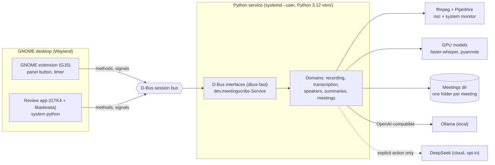
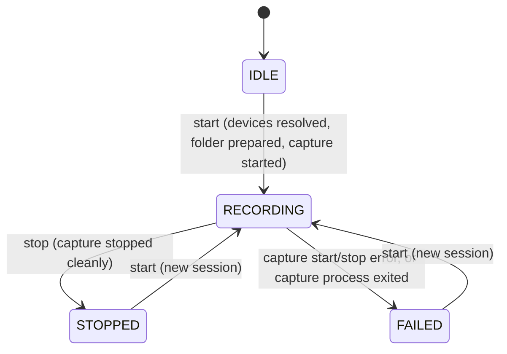
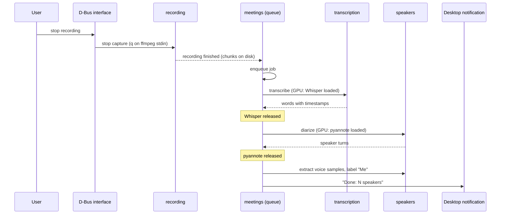

# Architecture — meeting-scribe

Local, GPU-accelerated meeting assistant for GNOME. Product context: [`PRD.md`](PRD.md).

---

## 1. System context

| Element | Technology | Status |
|---|---|---|
| Service | Python 3.12, dbus-fast (asyncio), `systemd --user` | composition root serves the `Recording1` D-Bus interface (`create_app`, `serve`, `run`); more interfaces in later phases, unit file and activation in F6 |
| GNOME extension | GJS, thin client, no ML | planned (F2), [ADR-001](docs/decisions/001-thin-gnome-extension-dbus-service.md) |
| Capture | ffmpeg on PipeWire, 2-channel 30 s chunks | adapter built (F1.3), wiring planned (F1.4), [ADR-002](docs/decisions/002-separate-mic-and-system-audio-tracks.md) |
| Transcription | faster-whisper `large-v3-turbo`, float16, CUDA | planned (F3) |
| Diarization | pyannote `speaker-diarization-community-1` | planned (F3) |
| Review UI | Native GTK4 + libadwaita app on system python, thin D-Bus client | planned (F4), [ADR-005](docs/decisions/005-review-ui-native-gtk-app.md) |
| Summaries | `SummaryProvider` port, OpenAI-compatible adapter | planned (F5), [ADR-006](docs/decisions/006-summary-provider-openai-compatible.md) |
| Storage | folder per meeting + versioned `meeting.json` | planned (F3), [ADR-004](docs/decisions/004-folder-per-meeting-json-storage.md) |

---

## 2. Bounded contexts

Source root: `src/meeting_scribe/`. Each package has `domain/`, `application/`, `infrastructure/`.

| Package | Responsibility |
|---|---|
| `base/` | Shared kernel: `BaseEntity` (frozen, null-object support), error hierarchy with stable `error_code`, logging setup |
| `recording/` | Start/stop capture, recording session state, PipeWire/ffmpeg adapter |
| `transcription/` | Audio to words with timestamps (faster-whisper adapter) |
| `speakers/` | Diarization (pyannote adapter), voice samples, rename, merge, "Me" labelling |
| `summaries/` | `SummaryProvider` port and OpenAI-compatible adapter (Ollama / DeepSeek) |
| `meetings/` | Meeting catalog, `MeetingRepository`, post-recording pipeline orchestration and job queue |
| `settings.py` | Root `Settings` composed of per-domain settings classes |
| `main.py` | Composition root: `create_app(settings)`, `run()` |

### Recording session

`RecordingController` (application) holds the single in-progress `RecordingSession` (domain entity) in memory and
talks to the outside only through ports: `Clock`, `AudioDeviceResolver`, `AudioCapture`, `RecordingStorage`.
Session id and folder name are the local start time, `YYYY-MM-DD_HHMMSS`; audio chunks go to `<folder>/audio/`.

`IDLE` is the absence of a session (null object); the entity itself only has `RECORDING`, `STOPPED` and `FAILED`.
`status()` detects a crashed capture (`is_running()` false while `RECORDING`) and moves the session to `FAILED`;
chunks already on disk are kept.

**Capture adapter** (`recording/infrastructure/`): `PactlDeviceResolver` asks `pactl` for the default sink (monitor =
`<sink>.monitor`) and default source (microphone). `FfmpegAudioCapture` runs one ffmpeg process built by the pure
`build_ffmpeg_command`: each input is converted to mono at `RECORDING_SAMPLE_RATE`, then `amerge` makes a 2-channel
stream, so **channel 0 = microphone, channel 1 = system** (ADR-002), `pcm_s16le`, cut by the segment muxer. Files in
the session folder: `audio/chunk_%05d.wav` (`chunk_00000.wav`, ...) and `ffmpeg.log` (ffmpeg stderr, appended). Stop
sends `q` on stdin and waits `RECORDING_STOP_TIMEOUT_SECONDS`; if ffmpeg does not exit it is terminated (SIGTERM), then
killed (SIGKILL) after 2 s, and `stop` returns a failure that says which one happened. Every wait is bounded: the
worst case is stop timeout + 2 s + 2 s (14 s with the defaults). A process that survives SIGKILL is reported as "could
not be reaped" and its handle is kept so a later call can retry. Exit code 0 is a clean stop. When the process dies
on its own, `AudioCapture.exit_detail()` gives the exit code plus the `ffmpeg.log` tail, and the controller stores it
as the session `failure_reason` (generic text only when empty). Opening `ffmpeg.log` and spawning ffmpeg fail with
distinct messages. Not yet wired into `main.py` (F1.4).

The GNOME extension lives in `gnome-extension/` (F2 in progress) and the GTK review app in a separate top-level directory (planned, F4), both outside the Python package. Packaging files (systemd `--user` unit template and D-Bus activation file, installed in F6) live in `packaging/`.

Extension layout (`gnome-extension/`): the extension itself is `meeting-scribe@meetingscribe.dev/`. Presentation logic (view model, elapsed formatting, D-Bus error to message mapping) lives in pure ES modules under `lib/` with no `gi://` or `resource:///org/gnome/shell/` imports, translated through an injected `_` function, and is unit-tested with `gjs -m` (`make test-extension`, tests in `gnome-extension/tests/`). Code that touches the Shell (`extension.js`, F2.3) and the D-Bus client (F2.2) stays thin and only wires those modules.

---

## 3. Layering rules

Inside every package the dependency direction is `infrastructure` -> `application` -> `domain`.

| Layer | Contains | May import |
|---|---|---|
| `domain/` | Entities, value objects, ports, errors | stdlib, pydantic, returns. No framework code. |
| `application/` | `*_controller.py` returning `Result[T, E]` | its own `domain` |
| `infrastructure/` | Adapters, `dbus/*_interface.py`, repositories | `application`, `domain`, frameworks |

Cross-package rules: `recording`, `transcription`, `speakers` and `summaries` never import each other. Only
`meetings` depends on them, and only through their `application` layer. `base` depends on no domain, and no
package imports `settings` or `main` (settings are injected from the composition root).

### Enforced contracts

Defined in `pyproject.toml` under `[tool.importlinter]` (`root_package = "meeting_scribe"`,
`include_external_packages = true`) and checked by `make imports` (part of `make lint` and `make check`):

| # | Name | Type | Rule |
|---|---|---|---|
| 1 | Domains recording, transcription, speakers and summaries are independent | independence | `recording`, `transcription`, `speakers`, `summaries` do not import each other |
| 2 | Layers per package: infrastructure > application > domain | layers | In `base`, `recording`, `transcription`, `speakers`, `summaries`, `meetings`: `infrastructure` may import `application` may import `domain`, never the reverse |
| 3 | meetings only depends on other domains through their application layer | forbidden | `meetings` may not import `<domain>.domain` or `<domain>.infrastructure` of `recording`, `transcription`, `speakers`, `summaries` (`allow_indirect_imports = true`) |
| 4 | Shared kernel does not depend on the domains | forbidden | `base` may not import any domain or `meetings` (`settings`/`main` are covered by contract 6) |
| 5 | Domain layers do not import frameworks | forbidden | every `<package>.domain` (including `base` and `meetings`) may not import `pydantic_settings`, `dbus_fast`, `gi` |
| 6 | Domain packages do not import settings or the composition root | forbidden | `base` and all domain packages may not import `meeting_scribe.main` or `meeting_scribe.settings` |

---

## 4. Post-recording pipeline

Orchestration lives in `meetings` (planned, F3). Decision record: [ADR-003](docs/decisions/003-process-after-stop-single-gpu-worker.md).

---

## 5. GPU policy

Target GPU: RTX 5060 Laptop, 8 GB.

- **Lazy load**: a model is loaded when its stage starts, never at service start.
- **Release between stages**: Whisper is freed before pyannote loads (the prototype kept both resident).
- **One GPU job at a time**: a single worker drains the queue; recording itself uses no GPU.
- **Resume**: pending jobs are re-enqueued at service start.
- **Explicit failures**: CUDA library preload failures are logged; CPU fallback happens only when CUDA is genuinely unavailable and is announced.

---

## 6. D-Bus API (`Recording1` implemented, others planned)

All clients (extension, review app, e2e tests) use the session bus; there is no HTTP server ([ADR-001](docs/decisions/001-thin-gnome-extension-dbus-service.md)).
Names are proposed and renamable until F6. The contract lives in [`docs/architecture/api-contracts.md`](docs/architecture/api-contracts.md).

| Item | Value |
|---|---|
| Bus name | `dev.meetingscribe.Service` |
| Object path | `/dev/meetingscribe/Service` |
| `dev.meetingscribe.Recording1` (implemented, F1.4) | `Start`, `Stop`; properties `State`, `SessionId`, `ElapsedSeconds`, `Directory`, `FailureReason`; signal `StateChanged` |
| `dev.meetingscribe.Meetings1` (planned) | list/get; signal `ProcessingFinished` |
| `dev.meetingscribe.Speakers1` | rename, merge, sample path |
| `dev.meetingscribe.Summaries1` | generate/read summary |
| Errors | `dev.meetingscribe.Error.<ERROR_CODE>` (see [error codes](docs/architecture/error-codes-catalog.md)) |
| Activation | `systemd --user` unit plus D-Bus session activation file (F6) |

Trust boundary: the session bus is per-user and unreachable from websites; any process of the same user can call the
service, the same boundary as the user's files. The service runs one asyncio loop; ML work runs off the event loop
so D-Bus stays responsive. The review app runs on system Python ([ADR-005](docs/decisions/005-review-ui-native-gtk-app.md)).
Tooling: `gdbus call` or `busctl --user`. E2E tests (`@pytest.mark.dbus`) start a private `dbus-daemon`, connect to its
address explicitly and wire the controller with fakes; they never touch the user's session bus or an audio device.
The service itself runs in the foreground (`make run`, `meeting-scribe`), exits non-zero if the bus name is already
owned (1), stops an active recording on SIGINT/SIGTERM, exits 2 if that stop fails and 3 if the bus connection is lost
(the recording is stopped first, so ffmpeg is never left running unreachable). Shutdown lets the crash monitor finish
its current poll before stopping, so controller calls never overlap.

---

## 7. Configuration

`Settings` (root) composes per-domain classes via `Field(default_factory=...)`. All inherit the shared
`MeetingScribeSettings` base (`extra="ignore"`, `case_sensitive=False`, utf-8) and only set their own
`env_prefix`. The base class lives in `base/infrastructure/settings.py` (re-exported by `meeting_scribe.settings`) so
domain infrastructure can inherit it without importing the root settings module (import contract 6). `get_settings()` is `lru_cache`d. Template: [`.env.example`](.env.example).

Env file resolution (once, in the base class): `$XDG_CONFIG_HOME/meeting-scribe/.env` (default
`~/.config/meeting-scribe/.env`) if it exists, otherwise `./.env` in the CWD (development). Process environment
variables always win. `Settings.load()` (behind `get_settings()`) notes the env file in effect in `Settings.env_files` (a best-effort lookup for the startup log, resolved separately from the settings sources), and `create_app` logs
that file at INFO (path only, never values); settings injected into `create_app` are logged as "settings injected by
caller" instead of re-resolving. Under `systemd --user` the CWD is not the project, so use the XDG path.

| Variable | Settings class | Default | Meaning |
|---|---|---|---|
| `LOG_LEVEL` | `Settings.log_level` | `INFO` | One of DEBUG, INFO, WARNING, ERROR, CRITICAL (case-insensitive); invalid fails at load |
| `STORAGE_MEETINGS_DIR` | `StorageSettings.meetings_dir` | `~/Documents/meetings` | Where meetings are stored (`~` is expanded) |
| `RECORDING_CHUNK_SECONDS` | `RecordingSettings.chunk_seconds` | `30` | Length of each audio chunk (>= 1) |
| `RECORDING_STOP_TIMEOUT_SECONDS` | `RecordingSettings.stop_timeout_seconds` | `10` | Wait for ffmpeg to exit after `q` before terminating (> 0) |
| `RECORDING_FFMPEG_BINARY` | `RecordingSettings.ffmpeg_binary` | `ffmpeg` | ffmpeg executable name or path |
| `RECORDING_SAMPLE_RATE` | `RecordingSettings.sample_rate` | `16000` | Sample rate of the recorded chunks (Hz) |

`RecordingSettings` lives in `recording/infrastructure/recording_settings.py`. Future per-domain settings (for example `TRANSCRIPTION_`,
`SUMMARIES_`) live in each domain's `infrastructure/` and are composed into `Settings` by the root.

---

## 8. Decisions (ADRs)

| ADR | Decision |
|---|---|
| [001](docs/decisions/001-thin-gnome-extension-dbus-service.md) | Thin GNOME extension + local Python service over the D-Bus session bus |
| [002](docs/decisions/002-separate-mic-and-system-audio-tracks.md) | Separate mic and system tracks in 2-channel chunks |
| [003](docs/decisions/003-process-after-stop-single-gpu-worker.md) | Process after stop; single GPU worker |
| [004](docs/decisions/004-folder-per-meeting-json-storage.md) | Folder per meeting with versioned `meeting.json` |
| [005](docs/decisions/005-review-ui-native-gtk-app.md) | Review UI as a native GTK4 + libadwaita app |
| [006](docs/decisions/006-summary-provider-openai-compatible.md) | `SummaryProvider` port, OpenAI-compatible adapter |

Related: [error codes](docs/architecture/error-codes-catalog.md) · [rules registry](docs/project/rules-registry.md) · [scope](docs/project/mvp-scope.md).
