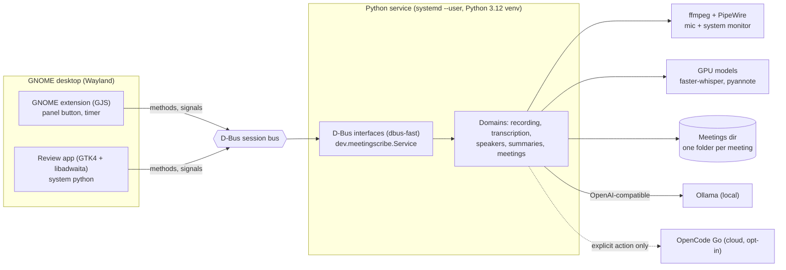
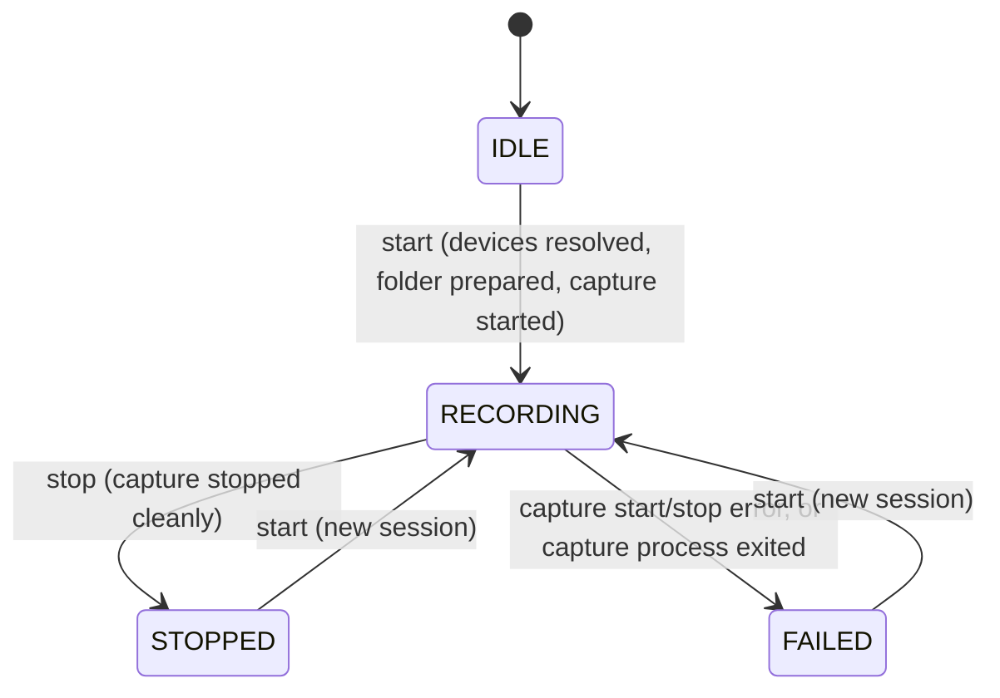
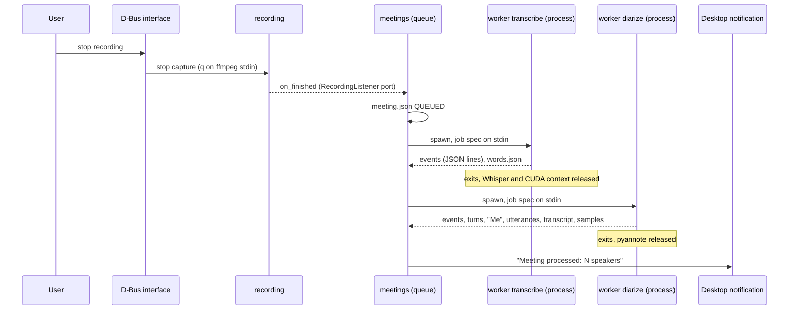

# Architecture — meeting-scribe

Local, GPU-accelerated meeting assistant for GNOME. Product context: [`PRD.md`](PRD.md).

---

## 1. System context

| Element | Technology | Status |
|---|---|---|
| Service | Python 3.12, dbus-fast (asyncio), `systemd --user` | composition root serves the `Recording1` D-Bus interface (`create_app`, `serve`, `run`); more interfaces in later phases, unit file and activation installed by `make install` (F2.5) |
| GNOME extension | GJS, thin client, no ML | done (F2), [ADR-001](docs/decisions/001-thin-gnome-extension-dbus-service.md) |
| Capture | ffmpeg on PipeWire, 2-channel 30 s chunks | adapter built (F1.3) and wired in `main.py` (F1.4), [ADR-002](docs/decisions/002-separate-mic-and-system-audio-tracks.md) |
| Transcription | faster-whisper `large-v3-turbo`, float16, CUDA, in a short-lived worker process | built (F3.2) and wired into the service (F3.4a); [spec](docs/specs/processing.md), [ADR-007](docs/decisions/007-gpu-worker-subprocess.md) |
| Diarization | pyannote `speaker-diarization-community-1` on the system channel (the microphone in person), in a short-lived worker process; then "Me", assignment, `transcript.md` and per-speaker voice samples | worker stage implemented (F3.3b; the real model run is pending the user's consent) and wired into the service (F3.4a), [spec](docs/specs/processing.md), [ADR-007](docs/decisions/007-gpu-worker-subprocess.md) |
| Review UI | Native GTK4 + libadwaita app on system python, thin D-Bus client | built (F4), [ADR-005](docs/decisions/005-review-ui-native-gtk-app.md) |
| Summaries | `SummaryProvider` port, OpenAI-compatible adapter | planned (F5), [ADR-006](docs/decisions/006-summary-provider-openai-compatible.md) |
| Storage | folder per meeting + versioned `meeting.json` | built (F3.1) and wired into the service (F3.4a), [ADR-004](docs/decisions/004-folder-per-meeting-json-storage.md) |

---

## 2. Bounded contexts

Source root: `src/meeting_scribe/`. Each package has `domain/`, `application/`, `infrastructure/`.

| Package | Responsibility |
|---|---|
| `base/` | Shared kernel: `BaseEntity` (frozen, null-object support), error hierarchy with stable `error_code` (including the shared GPU errors), D-Bus error mapping, logging setup and the shared settings base |
| `recording/` | Start/stop capture, recording session state, PipeWire/ffmpeg adapter |
| `transcription/` | Audio to words with timestamps (faster-whisper adapter) |
| `speakers/` | Diarization (pyannote adapter), voice samples, rename, merge, "Me" labelling |
| `summaries/` | `SummaryProvider` port and OpenAI-compatible adapter (Ollama / OpenCode Go) |
| `preferences/` | The few user-editable settings: the `FieldSpec` registry, the JSON settings file store, the meetings-folder check the use cases (`PreferencesService`, `RestartService`), the systemd restarter and the `Settings1` adapter; validators are injected by the composition root ([spec](docs/specs/preferences.md)) |
| `meetings/` | Meeting catalog, `MeetingRepository`, post-recording pipeline orchestration and job queue, worker protocol and subprocess runner, WAV readers |
| `settings.py` | Root `Settings` composed of per-domain settings classes |
| `main.py` | Composition root: `create_app(settings)`, `run()` |

### Recording session

`RecordingController` (application) holds the single in-progress `RecordingSession` (domain entity) in memory and
talks to the outside only through ports: `Clock`, `AudioDeviceResolver`, `AudioCapture`, `RecordingStorage`.
Session id and folder name are the local start time, `YYYY-MM-DD_HHMMSS`; audio chunks go to `<folder>/audio/`.

`IDLE` is the absence of a session (null object); the entity itself only has `RECORDING`, `STOPPED` and `FAILED`.
`status()` detects a crashed capture (`is_running()` false while `RECORDING`) and moves the session to `FAILED`;
chunks already on disk are kept.

**Capture adapter** (`recording/infrastructure/`): `PactlDeviceResolver` asks `pactl` for the default sink (monitor =
`<sink>.monitor`) and default source (microphone). `FfmpegAudioCapture` runs one ffmpeg process built by the pure
`build_ffmpeg_command`: each input is converted to mono at `RECORDING_SAMPLE_RATE`, then `amerge` makes a 2-channel
stream, so **channel 0 = microphone, channel 1 = system** (ADR-002), `pcm_s16le`, cut by the segment muxer. Files in
the session folder: `audio/chunk_%05d.wav` (`chunk_00000.wav`, ...) and `ffmpeg.log` (ffmpeg stderr, appended). Stop
sends `q` on stdin and waits `RECORDING_STOP_TIMEOUT_SECONDS`; if ffmpeg does not exit it is terminated (SIGTERM), then
killed (SIGKILL) after 2 s, and `stop` returns a failure that says which one happened. Every wait is bounded: the
worst case is stop timeout + 2 s + 2 s (14 s with the defaults). A process that survives SIGKILL is reported as "could
not be reaped" and its handle is kept so a later call can retry. Exit code 0 is a clean stop. When the process dies
on its own, `AudioCapture.exit_detail()` gives the exit code plus the `ffmpeg.log` tail, and the controller stores it
as the session `failure_reason` (generic text only when empty). Opening `ffmpeg.log` and spawning ffmpeg fail with
distinct messages. Wired in `main.py`.

The GNOME extension lives in `gnome-extension/` (F2, done) and the GTK review app in a separate top-level directory `review-app/` (F4), both outside the Python package. Packaging files (systemd `--user` unit template and D-Bus activation file, installed by `make install`) live in `packaging/`.

Extension layout (`gnome-extension/`): the extension itself is `meeting-scribe@meetingscribe.dev/`. Presentation logic (view model, elapsed formatting, D-Bus error to message mapping) lives in pure ES modules under `lib/` with no `gi://` or `resource:///org/gnome/shell/` imports, translated through an injected `_` function, and is unit-tested with `gjs -m` (`make test-extension`, tests in `gnome-extension/tests/`). Code that touches the Shell (`extension.js`, `lib/panelIndicator.js`, `lib/glibScheduler.js`) stays thin and only wires those modules.

Extension layering is model, then controller, then Shell glue. `lib/indicatorModel.js` turns a client snapshot into a view model. `lib/indicatorController.js` (pure, with injected `client`, `view`, `scheduler`, `notify` and `_`) renders on every client change, runs a 1 s tick only while the state is `RECORDING` (cancelled on stop, failure, service loss and `destroy()`), performs the model's `clickAction`, and reports failed calls through `notify` with `errorMessage()`. `lib/panelIndicator.js` is the `PanelMenu.Button` that renders the model; it replaces the button's menu with a subclass whose `toggle()` asks the controller first, and every state opens the menu: starting and stopping are always explicit menu actions, so a stray click never records (CR-013). `extension.js` creates the scheduler, indicator, client and controller in `enable()`, adds the button with `Main.panel.addToStatusArea()` and destroys everything in reverse order in `disable()` (GO-030). Shell-only files are never executed by tests: `make test-extension` parses them with `node --check` and validates `metadata.json` (GO-031).

Packaging: `make extension-pack` runs `gnome-extensions pack` with `--extra-source=lib` (it picks up `metadata.json`, `extension.js` and `stylesheet.css` itself) into `dist/`; `make extension-install` installs the zip without enabling it. Try-out and install steps are in [the runbook](docs/runbooks/gnome-extension.md).

The D-Bus client (`lib/recordingClient.js`) takes an injectable bus connection and clock, does nothing until `connect()` and releases everything in `destroy()`. It watches the service's bus name (no autostart, so the extension never launches the service) and creates the `Recording1` proxy only while the name has an owner. Its snapshot (`available`, `busy`, `state`, `sessionId`, `elapsedSeconds`, `failureReason`) feeds `viewModel()` and updates from `PropertiesChanged` and `StateChanged`. The service does not announce `ElapsedSeconds`, so the client reads it once when a recording starts (or is joined) and counts locally on the monotonic clock; the shell's 1 s timer (F2.3) only re-reads `snapshot`. A late seed reply from an earlier recording is dropped (a counter bumped on every entry into RECORDING), a transition into `FAILED` is reported only once its `FailureReason` is known (read with `Properties.Get`, because `StateChanged` carries none), and every call uses a 20 s timeout (`callTimeoutMs`: `Stop` blocks up to `RECORDING_STOP_TIMEOUT_SECONDS` + 4 s in the service). Tests run it against a fake `Recording1` on a private `dbus-daemon` (`gnome-extension/tests/privateBus.js`, GO-029).

`lib/meetingsClient.js` is the same kind of client for `Meetings1` (F3.4b): its snapshot (`available`, `activeMeetingId`, `activeState`, `queuedCount`, `last`) goes to `viewModel()` as `processing`, which appends the processing lines after the recording items; the controller takes it as an optional `meetings` collaborator, re-renders on `handleProcessingChange()` and runs the `reprocess` menu action for a `FAILED` last result.

---

## 3. Layering rules

Inside every package the dependency direction is `infrastructure` -> `application` -> `domain`.

| Layer | Contains | May import |
|---|---|---|
| `domain/` | Entities, value objects, ports, errors | stdlib, pydantic, returns. No framework code. |
| `application/` | `*_controller.py` returning `Result[T, E]` | its own `domain` |
| `infrastructure/` | Adapters, `dbus/*_interface.py`, repositories | `application`, `domain`, frameworks |

Cross-package rules: `recording`, `transcription`, `speakers` and `summaries` never import each other. Only
`meetings` depends on them, and only through their `application` layer. `base` depends on no domain, and no
package imports `settings` or `main` (settings are injected from the composition root).

### Enforced contracts

Defined in `pyproject.toml` under `[tool.importlinter]` (`root_packages = ["meeting_scribe", "meeting_scribe_review"]`,
`include_external_packages = true`; `make imports` puts `review-app/src` on `PYTHONPATH` so the app package resolves) and checked by `make imports` (part of `make lint` and `make check`):

| # | Name | Type | Rule |
|---|---|---|---|
| 1 | Domains recording, transcription, speakers and summaries are independent | independence | `recording`, `transcription`, `speakers`, `summaries` and `preferences` do not import each other |
| 2 | Layers per package: infrastructure > application > domain | layers | In `base`, `recording`, `transcription`, `speakers`, `summaries`, `meetings`, `preferences`: `infrastructure` may import `application` may import `domain`, never the reverse |
| 3 | meetings only depends on other domains through their application layer | forbidden | `meetings` may not import `<domain>.domain` or `<domain>.infrastructure` of `recording`, `transcription`, `speakers`, `summaries` (`allow_indirect_imports = true`) |
| 4 | Shared kernel does not depend on the domains | forbidden | `base` may not import any domain, `meetings` or `preferences` (`settings`/`main` are covered by contract 6) |
| 5 | Domain layers do not import frameworks | forbidden | every `<package>.domain` (including `base`, `meetings` and `preferences`) may not import `pydantic_settings`, `dbus_fast`, `gi` |
| 6 | Domain packages do not import settings or the composition root | forbidden | `base` and all domain packages (including `preferences`) may not import `meeting_scribe.main` or `meeting_scribe.settings` |
| 7 | The service never imports ML libraries (only the two backends do, in the worker) | forbidden | no module of `meeting_scribe` may import `faster_whisper`, `ctranslate2`, `torch`, `torchaudio` or `pyannote`, except the faster-whisper backend (`faster_whisper`, `ctranslate2`) and the pyannote backend (`torch`, `pyannote`), both loaded only in the worker |
| 8 | The service entry point never reaches the worker or its ML backends | forbidden | `meeting_scribe.main` may not import `meeting_scribe.worker` or the faster-whisper backend, directly or indirectly |
| 9 | The app core never imports gi | forbidden | `meeting_scribe_review.core` may not import `gi` (only `ui` does, F4.5) |
| 10 | The app and the service are independent | independence | `meeting_scribe` and `meeting_scribe_review` never import each other; the app reaches the service over D-Bus only |
| 11 | The app has no service-side dependencies | forbidden | `meeting_scribe_review` may not import `pydantic`, `pydantic_settings`, `returns`, `dbus_fast` or `numpy` (it runs on system Python) |
| 12 | App layers: ui over core | layers | `meeting_scribe_review.ui` may import `core`, never the reverse |
| 13 | Summaries domain and application stay free of HTTP and settings libraries | forbidden | `summaries.domain` and `summaries.application` may not import `httpx`, `httpx2`, `openai`, `pydantic_settings` or `dbus_fast`; `openai` and `httpx2` are confined to `summaries.infrastructure` by contract 14 |
| 14 | The openai client and httpx2 are imported only by summaries.infrastructure | forbidden | No `meeting_scribe` module may import `openai` or `httpx2`, except the adapters `summaries.infrastructure.openai_provider` and `ollama_releaser` (allowed by `ignore_imports`) |
| 15 | Preferences application stays free of D-Bus and settings libraries | forbidden | `preferences.application` may not import `dbus_fast`, `pydantic_settings` or `gi`; the `Settings1` adapter and the file store live in `preferences.infrastructure` |

---

## 4. Post-recording pipeline

Orchestration lives in `meetings` (built in F3.1, wired in F3.4a: `main.py` builds `ProcessingConfig` from the settings, `meeting_scribe/handoff.py` adapts the `RecordingListener` port to `ProcessingController`, and `serve()` resumes unfinished jobs and runs the loop in its own thread; the D-Bus `Meetings1` interface and the desktop notification are F3.4a too: `MeetingsInterface` is a `ProcessingEvents` observer on a `ProcessingEventHub`, so its signals and `PropertiesChanged` follow the persisted states, and `NotifyOnFinish` sends one `org.freedesktop.Notifications` message per finished job unless `PROCESSING_NOTIFY=false`; the extension is F3.4b): one FIFO queue persisted in each `meeting.json`, states `QUEUED`, `TRANSCRIBING`, `DIARIZING`, `EXTRACTING_SAMPLES`, `DONE` or `FAILED`, resumed at service start. Transcription hears the mean of both channels; diarization runs on the system channel only, and "Me" comes from per-frame mic versus system energy dominance with loudspeaker bleed compensation (ADR-002). The contract is the [processing spec](docs/specs/processing.md). Summaries (F5.4) also live in `meetings`: `SummaryController` snapshots under the meeting lock, runs the model on one job thread outside it, and saves `summary.md` then the `summary` section of `meeting.json`; a `GpuLease` shared with `ProcessingController` keeps a local summary and a worker off the GPU together and lets a recording cancel the summary. Decision records: [ADR-003](docs/decisions/003-process-after-stop-single-gpu-worker.md), [ADR-007](docs/decisions/007-gpu-worker-subprocess.md).

---

## 5. GPU policy

Target GPU: RTX 5060 Laptop, 8 GB.

- **Lazy load**: a model is loaded when its stage starts, never at service start.
- **Release by process exit** (ADR-007): each GPU stage runs in its own short-lived worker process (`python -m meeting_scribe.worker transcribe|diarize`), so Whisper and pyannote are never resident together and all VRAM, including the CUDA context, returns when the worker exits. `torch.cuda.empty_cache()` alone cannot guarantee that. The service process never imports torch, CTranslate2, faster-whisper or pyannote.
- **One GPU job at a time**: a single queue drains jobs FIFO; recording itself uses no GPU, and a recording that starts stops the running worker (its job returns to the queue head in its current state) and no worker runs until the recording ends (spec OQ-3, `RecordingListener`).
- **Resume**: unfinished jobs are re-enqueued at service start; stage caches keyed on parameters and audio skip completed work.
- **Explicit failures**: CUDA library preload failures are logged; `PROCESSING_DEVICE=cuda` never falls back silently (`GPU_UNAVAILABLE`), the CPU is used only when configured, and a worker crash or timeout fails the job without touching the service.

---

## 6. D-Bus API (`Recording1`, `Meetings1`, `Summaries1` and `Settings1` implemented, others planned)

All clients (extension, review app, e2e tests) use the session bus; there is no HTTP server ([ADR-001](docs/decisions/001-thin-gnome-extension-dbus-service.md)).
Names are proposed and renamable until F6. The contract lives in [`docs/architecture/api-contracts.md`](docs/architecture/api-contracts.md).

| Item | Value |
|---|---|
| Bus name | `dev.meetingscribe.Service` |
| Object path | `/dev/meetingscribe/Service` |
| `dev.meetingscribe.Recording1` (implemented, F1.4) | `Start`, `Stop`; properties `State`, `SessionId`, `ElapsedSeconds`, `Directory`, `FailureReason`; signal `StateChanged` |
| `dev.meetingscribe.Meetings1` (implemented, F3.4a) | `List`, `Get`, `Reprocess`; properties `ActiveMeetingId`, `ActiveState`, `QueuedCount`; signals `ProcessingStateChanged`, `ProcessingFinished` ([spec](docs/specs/processing.md) section 8) |
| `dev.meetingscribe.Speakers1` | rename, merge, sample path |
| `dev.meetingscribe.Summaries1` (implemented, F5.5) | `Providers`, `Summarize`, `CancelSummary`, `GetSummaryStatus`, `GetSummary`, `LastSummary`; property `ActiveSummaryMeetingId`; signals `SummaryProgress`, `SummaryFinished` ([spec](docs/specs/summaries.md) section 10) |
| `dev.meetingscribe.Settings1` (implemented, F5.10) | `GetAll`, `Set` (all or nothing, per-field error rows), `Restart` (systemd, only when idle); property `RestartRequired`; signal `SettingsChanged` ([spec](docs/specs/preferences.md) section 4). The API key never crosses it |
| Errors | `dev.meetingscribe.Error.<ERROR_CODE>` (see [error codes](docs/architecture/error-codes-catalog.md)) |
| Activation | `systemd --user` unit plus D-Bus session activation file, installed by `make install` |

Trust boundary: the session bus is per-user and unreachable from websites; any process of the same user can call the
service, the same boundary as the user's files. The service runs one asyncio loop; ML work runs off the event loop
so D-Bus stays responsive. The review app runs on system Python ([ADR-005](docs/decisions/005-review-ui-native-gtk-app.md)).
Tooling: `gdbus call` or `busctl --user`. E2E tests (`@pytest.mark.dbus`) start a private `dbus-daemon`, connect to its
address explicitly and wire the controller with fakes; they never touch the user's session bus or an audio device.
`make install` (`scripts/install.sh`) installs the service as a `uv tool` (Python 3.12, with the `ml` extra) into a fresh `${XDG_DATA_HOME:-~/.local/share}/meeting-scribe/versions/<timestamp>-<pid>/` directory, verifies it, repoints the `current` symlink the unit runs, rolls back to the previous version if the new one fails to start and prunes old versions; it renders the unit with the absolute `ExecStart`, copies the activation file, runs `systemctl --user enable --now` (restart on upgrade, never while recording), then runs `meeting-scribe prefetch-models` (entry point `meeting_scribe.cli`, kept apart from `main` so the service never reaches the ML backends) to download the Whisper model and the pyannote pipeline into the Hugging Face cache (a failure is reported in the summary and never fails the install; the worker runs with `HF_HUB_OFFLINE=1`), and packs, installs and enables the extension; `make uninstall` reverses it and never touches the meetings directory or `.env`. The service can also run in the foreground for development (`make run`, `meeting-scribe`); it exits non-zero if the bus name is already
owned (1), stops an active recording on SIGINT/SIGTERM, exits 2 if that stop fails and 3 if the bus connection is lost
(the recording is stopped first, so ffmpeg is never left running unreachable). Shutdown lets the crash monitor finish
its current poll before stopping, so controller calls never overlap.

---

## 7. Configuration

`Settings` (root) composes per-domain classes via `Field(default_factory=...)`. All inherit the shared
`MeetingScribeSettings` base (`extra="ignore"`, `case_sensitive=False`, utf-8) and only set their own
`env_prefix`. The base class lives in `base/infrastructure/settings.py` (re-exported by `meeting_scribe.settings`) so
domain infrastructure can inherit it without importing the root settings module (import contract 6). `get_settings()` is `lru_cache`d. Template: [`.env.example`](.env.example).

Precedence, highest first: process environment, `.env`, `settings.json` (the user's saved values from the
Preferences window, `$XDG_CONFIG_HOME/meeting-scribe/settings.json`, JSON `{"version": 1, "values": {...}}`, sparse,
mode `0600` in a `0700` folder, written atomically), then defaults. The saved values enter as a settings source
below the dotenv source (`file_layer` in `base/infrastructure/settings.py`), so only `Settings.load(file_values=...)`
and `Settings.with_overrides(values)` read them; constructors with explicit arguments are unchanged. Only five fields are
exposed in the file (`summaries.provider`, `summaries.local_model`, `summaries.language`, `summaries.cloud_model`,
`storage.meetings_dir`); `Settings.source_of(key)` reports the winning layer (`default`, `file`, `env`, `dotenv`) and
whether it locks the field. The API key is never a setting (BR-005).

Env file resolution (once, in the base class): `$XDG_CONFIG_HOME/meeting-scribe/.env` (default
`~/.config/meeting-scribe/.env`) if it exists, otherwise `./.env` in the CWD (development). Process environment
variables always win. `Settings.load()` (behind `get_settings()`) notes the env file in effect in `Settings.env_files` (a best-effort lookup for the startup log, resolved separately from the settings sources), and `create_app` logs
that file at INFO (path only, never values); settings injected into `create_app` are logged as "settings injected by
caller" instead of re-resolving. Under `systemd --user` the CWD is not the project, so use the XDG path.

| Variable | Settings class | Default | Meaning |
|---|---|---|---|
| `LOG_LEVEL` | `Settings.log_level` | `INFO` | One of DEBUG, INFO, WARNING, ERROR, CRITICAL (case-insensitive); invalid fails at load |
| `STORAGE_MEETINGS_DIR` | `StorageSettings.meetings_dir` | `~/Documents/meetings` | Where meetings are stored (`~` is expanded) |
| `RECORDING_CHUNK_SECONDS` | `RecordingSettings.chunk_seconds` | `30` | Length of each audio chunk (>= 1) |
| `RECORDING_STOP_TIMEOUT_SECONDS` | `RecordingSettings.stop_timeout_seconds` | `10` | Wait for ffmpeg to exit after `q` before terminating (> 0) |
| `RECORDING_FFMPEG_BINARY` | `RecordingSettings.ffmpeg_binary` | `ffmpeg` | ffmpeg executable name or path |
| `RECORDING_SAMPLE_RATE` | `RecordingSettings.sample_rate` | `16000` | Sample rate of the recorded chunks (Hz) |
| `PROCESSING_DEVICE` | `ProcessingSettings.device` | `cuda` | `cuda` or `cpu`; no automatic fallback |
| `PROCESSING_WORKER_TIMEOUT_FACTOR` | `ProcessingSettings.worker_timeout_factor` | `1.0` | Stage timeout as a multiple of the audio length (> 0) |
| `PROCESSING_WORKER_MIN_TIMEOUT_SECONDS` | `ProcessingSettings.worker_min_timeout_seconds` | `900` | Lower bound of the stage timeout (> 0) |
| `PROCESSING_WORKER_KILL_GRACE_SECONDS` | `ProcessingSettings.worker_kill_grace_seconds` | `5` | SIGTERM to SIGKILL grace (> 0) |
| `PROCESSING_STORAGE_RETRY_DELAYS_SECONDS` | `ProcessingSettings.storage_retry_delays_seconds` | `[2, 8, 30]` | JSON list; delay before each retry of a job whose `meeting.json` could not be saved or read (each > 0, at least one) |
| `PROCESSING_NOTIFY` | `ProcessingSettings.notify` | `true` | Desktop notification when a job ends (`false` turns it off) |
| `TRANSCRIPTION_MODEL` | `TranscriptionSettings.model` | `large-v3-turbo` | faster-whisper model name or path (not empty) |
| `TRANSCRIPTION_LANGUAGE` | `TranscriptionSettings.language` | `es` | ISO code, or `auto` to detect from the first 30 s |
| `TRANSCRIPTION_COMPUTE_TYPE` | `TranscriptionSettings.compute_type` | `float16` | CTranslate2 compute type on CUDA |
| `TRANSCRIPTION_CPU_COMPUTE_TYPE` | `TranscriptionSettings.cpu_compute_type` | `int8` | Compute type when `PROCESSING_DEVICE=cpu` |
| `TRANSCRIPTION_BEAM_SIZE` | `TranscriptionSettings.beam_size` | `5` | Beam size (>= 1) |
| `TRANSCRIPTION_VAD_FILTER` | `TranscriptionSettings.vad_filter` | `true` | Silero VAD pre-filter |
| `TRANSCRIPTION_CONDITION_ON_PREVIOUS_TEXT` | `TranscriptionSettings.condition_on_previous_text` | `false` | Feed the previous text back as a prompt (off avoids repetition loops on long audio) |
| `SPEAKERS_PIPELINE` | `SpeakersSettings.pipeline` | `pyannote/speaker-diarization-community-1` | pyannote pipeline id (not empty) |
| `SPEAKERS_NUM_SPEAKERS` | `SpeakersSettings.num_speakers` | unset | Exact remote speaker count (>= 1), or unset for automatic |
| `SPEAKERS_MIN_SPEAKERS` / `SPEAKERS_MAX_SPEAKERS` | `SpeakersSettings.min_speakers` / `max_speakers` | unset | Bounds when the count is automatic (min must not exceed max) |
| `SPEAKERS_UTTERANCE_GAP_SECONDS` | `SpeakersSettings.utterance_gap_seconds` | `5.0` | Same-speaker silence that still joins an utterance (>= 0) |
| `SPEAKERS_ME_DOMINANCE_DB` | `SpeakersSettings.me_dominance_db` | `6.0` | Residual mic energy over predicted bleed plus noise needed for "Me" (>= 0) |
| `SPEAKERS_ME_NOISE_MARGIN_DB` | `SpeakersSettings.me_noise_margin_db` | `10.0` | Residual mic energy over the mic noise floor needed for speech (>= 0) |
| `SPEAKERS_ME_MIN_TURN_SECONDS` | `SpeakersSettings.me_min_turn_seconds` | `0.5` | Shortest "Me" turn kept (> 0) |
| `SPEAKERS_SAMPLE_MAX_CLIPS` | `SpeakersSettings.sample_max_clips` | `3` | Clips per speaker sample (>= 1) |
| `SPEAKERS_SAMPLE_TARGET_SECONDS` | `SpeakersSettings.sample_target_seconds` | `15.0` | Target total sample length (> 0) |
| `SPEAKERS_SAMPLE_MIN_CLIP_SECONDS` / `SPEAKERS_SAMPLE_MAX_CLIP_SECONDS` | `SpeakersSettings.sample_min_clip_seconds` / `sample_max_clip_seconds` | `1.5` / `6.0` | Clip length bounds (min must not exceed max) |
| `SUMMARIES_PROVIDER` | `SummariesSettings.provider` | `local` | Provider the "Generate summary" button uses, `local` or `cloud` (choosing `cloud` is the opt-in and also needs a key; `SUMMARIES_CLOUD_ENABLED` was removed) |
| `SUMMARIES_LOCAL_BASE_URL` | `SummariesSettings.local_base_url` | `http://127.0.0.1:11434/v1` | Ollama OpenAI-compatible endpoint; the host must be `127.0.0.1`, `::1` or `localhost` |
| `SUMMARIES_LOCAL_MODEL` | `SummariesSettings.local_model` | `qwen3.5:9b` | Ollama model name |
| `SUMMARIES_LOCAL_CONTEXT_TOKENS` | `SummariesSettings.local_context_tokens` | `4096` | Window the service plans against; raise it together with Ollama's context (must exceed output limit + 600) |
| `SUMMARIES_UNLOAD_LOCAL_MODEL` | `SummariesSettings.unload_local_model` | `true` | Ask Ollama to unload the model after a local summary |
| `SUMMARIES_CLOUD_PROVIDER_NAME` | `SummariesSettings.cloud_provider_name` | `OpenCode Go` | Name shown in the "cloud" label (for example `cloud: OpenCode Go, deepseek-v4-pro`) |
| `SUMMARIES_CLOUD_BASE_URL` | `SummariesSettings.cloud_base_url` | `https://opencode.ai/zen/go/v1` | OpenAI-compatible cloud gateway; must be https ([ADR-009](docs/decisions/009-cloud-summaries-through-opencode-go.md)) |
| `SUMMARIES_CLOUD_MODEL` | `SummariesSettings.cloud_model` | `deepseek-v4-pro` | Any model the gateway serves on `/chat/completions`; models on `/responses` or `/messages` are not supported |
| `SUMMARIES_CLOUD_CONTEXT_TOKENS` | `SummariesSettings.cloud_context_tokens` | `100000` | Cloud budget the service plans against |
| `SUMMARIES_LANGUAGE` | `SummariesSettings.language` | `auto` | `auto` follows the meeting language, or an ISO code |
| `SUMMARIES_MAX_OUTPUT_TOKENS` | `SummariesSettings.max_output_tokens` | `2048` | Output limit per request (>= 256) |
| `SUMMARIES_TEMPERATURE` | `SummariesSettings.temperature` | `0.2` | Sampling temperature (0 to 1) |
| `SUMMARIES_TIMEOUT_SECONDS` | `SummariesSettings.timeout_seconds` | `300` | Seconds without data before a step times out (> 0) |
| `SUMMARIES_TOTAL_TIMEOUT_SECONDS` | `SummariesSettings.total_timeout_seconds` | `3600` | Bound for one whole summary (> 0) |
| `SUMMARIES_MAX_RETRIES` | `SummariesSettings.max_retries` | `2` | Retries for transient provider failures (>= 0) |

`RecordingSettings` lives in `recording/infrastructure/recording_settings.py`, `ProcessingSettings` in `meetings/infrastructure/processing_settings.py`, `TranscriptionSettings` in `transcription/infrastructure/transcription_settings.py`, `SummariesSettings` in `summaries/infrastructure/summaries_settings.py` (loopback and https validation, the "cloud" label and limits; the cloud API key is not a setting, it lives in the GNOME Keyring, [ADR-009](docs/decisions/009-cloud-summaries-through-opencode-go.md)), `SpeakersSettings` in `speakers/infrastructure/speakers_settings.py` (it builds the domain's `MeParams` and `SampleParams`; the worker reads the same values from the job spec as `DiarizationParams` and `AssemblyParams`). Future per-domain settings live in each domain's `infrastructure/` and are composed into `Settings` by the root.

---

## 8. Decisions (ADRs)

| ADR | Decision |
|---|---|
| [001](docs/decisions/001-thin-gnome-extension-dbus-service.md) | Thin GNOME extension + local Python service over the D-Bus session bus |
| [002](docs/decisions/002-separate-mic-and-system-audio-tracks.md) | Separate mic and system tracks in 2-channel chunks |
| [003](docs/decisions/003-process-after-stop-single-gpu-worker.md) | Process after stop; single GPU worker |
| [004](docs/decisions/004-folder-per-meeting-json-storage.md) | Folder per meeting with versioned `meeting.json` |
| [005](docs/decisions/005-review-ui-native-gtk-app.md) | Review UI as a native GTK4 + libadwaita app |
| [006](docs/decisions/006-summary-provider-openai-compatible.md) | `SummaryProvider` port, OpenAI-compatible adapter |
| [007](docs/decisions/007-gpu-worker-subprocess.md) | GPU work in short-lived worker processes, one per GPU stage |
| [008](docs/decisions/008-summary-sections.md) | The summary has a Decisions section |
| [009](docs/decisions/009-cloud-summaries-through-opencode-go.md) | Cloud summaries go through OpenCode Go |

Related: [error codes](docs/architecture/error-codes-catalog.md) · [rules registry](docs/project/rules-registry.md) · [scope](docs/project/mvp-scope.md).
