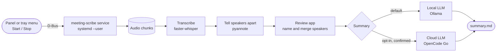

<div align="center">

# meeting-scribe

**Record, transcribe, tell speakers apart and summarize your meetings, entirely on your own Linux desktop: GNOME or KDE Plasma.**

[](LICENSE)
[](pyproject.toml)
[](gnome-extension/meeting-scribe@meetingscribe.dev/metadata.json)
[](docs/runbooks/desktop-tray.md)
[](#prerequisites)
[](#prerequisites)
[](#safety)
[](docs/project/mvp-scope.md)

[Install](#install-humans-and-ai-agents) ·
[How it works](#how-it-works) ·
[Prerequisites](#prerequisites) ·
[Documentation](#documentation) ·
[Safety](#safety)

</div>

---

A local, GPU-accelerated meeting assistant for the Linux desktop (Fedora, Wayland). Record from a panel button on
GNOME or from a tray icon on KDE Plasma and other desktops, get a transcript with speakers told apart, name or merge
speakers in a native GTK4 review app, and generate a summary with a local (Ollama) or opt-in cloud (OpenCode Go) LLM.
Everything runs on your machine; nothing leaves it unless you explicitly ask for a cloud summary.

## Highlights

| | |
|---|---|
| **One click from the top bar** | A GNOME Shell panel menu starts and stops the recording, shows the processing stage and opens the last review or summary. |
| **Or from the tray** | On KDE Plasma and other desktops with a tray, a tray icon offers the same menu and turns red while recording. |
| **Who said what** | Transcription with faster-whisper (`large-v3-turbo`) and speaker diarization with pyannote (`community-1`), on your NVIDIA GPU, with a "Me" label and a voice sample per speaker. |
| **A native review app** | A GTK 4 + libadwaita window to listen to each speaker, name them, merge or unmerge them and read the transcript. |
| **Summaries in the meeting's language** | Topics, decisions, tasks and open questions, from a local Ollama model by default or from OpenCode Go when you choose the cloud (labelled, and confirmed on every request). |
| **Preferences, not config files** | Provider, models (picked from lists, never typed), language, meetings folder, the cloud key and the Hugging Face token, the secrets kept in the GNOME Keyring. |
| **An install that explains itself** | `./install.sh --check` tells you what is missing, why, and the exact command to fix it, and never runs `sudo`. Readable by humans and AI agents (`--json`). |

## How it works



The GNOME extension (or, on other desktops, the tray) and the review app are thin clients of one service on the D-Bus
session bus (no HTTP server).
Transcription and diarization run in a GPU worker process, one model at a time, after you press Stop.

## Status

v1 is complete (tag `v1.0.0`); F6.5 is in progress. The phase table in [`mvp-scope.md`](docs/project/mvp-scope.md) is the
source of truth.

| Phase | What it delivers | Status |
|---|---|---|
| F0 Foundations | Scaffold, tooling, architecture contracts, ADRs | done |
| F1 Recording | `dev.meetingscribe.Recording1`, ffmpeg capture of microphone and system audio, systemd user service | done |
| F2 GNOME extension | Panel menu to start and stop, timer, processing state | done |
| F2.5 Install | One-command install and uninstall | done |
| F3 Processing | Transcription, speakers, "Me" label, voice samples, desktop notification, `Meetings1` | done |
| F4 Review app | Native GTK 4 window to listen to, name and merge speakers | done |
| F5 Summaries | Summary tab, local or cloud LLM, Preferences window, "Open last summary" | done |
| F6 Install | Read-only preflight, no `sudo`, models from Preferences, update and uninstall | done |
| F6.5 Desktop tray | Tray icon with the extension's menu for KDE Plasma and other desktops | in progress |
| F7 Polish | Summary quality, Preferences polish, CI | pending |


## Prerequisites

Fedora on Wayland, with GNOME (the top-bar extension) or another desktop such as KDE Plasma (the tray icon). `./install.sh --check` tests every row below, changes nothing and prints, for each
missing one, what is missing, why it is needed and the exact command to fix it (the installer never runs `sudo`: it
prints the command and you run it). A row marked "human" has no command: only you can do it (`./install.sh` exits 11
when only those remain, 10 when a command can fix something). The first column is the check id in the report.

| Check id | What | If missing | How to get it (Fedora) |
|---|---|---|---|
| `session.desktop` | The desktop, read from the session bus: GNOME Shell gets the extension, any other desktop gets the tray | never blocks | Nothing to install |
| `session.wayland` | A session on Wayland (`XDG_SESSION_TYPE=wayland`); outside GNOME Shell, X11 only warns (not tested) | human, blocks | Log out, pick a Wayland session ("GNOME", not "GNOME on Xorg"; on KDE "Plasma (Wayland)"), run the installer from a terminal in that session |
| `session.gnome-shell` | On GNOME Shell only (skipped elsewhere): GNOME Shell of a version listed in the extension's `metadata.json` (`shell-version`) | human, blocks | Use a GNOME session with that version |
| `session.bus` | The session bus (`DBUS_SESSION_BUS_ADDRESS` or `$XDG_RUNTIME_DIR/bus`) | human, blocks | Run the installer from a terminal inside your desktop session |
| `session.tray-host` | Outside GNOME Shell, a tray host (`org.kde.StatusNotifierWatcher`: KDE Plasma, Xfce, Cinnamon, LXQt, waybar) | optional | Enable the desktop's status notifier or tray applet |
| `tool.uv` | [`uv`](https://docs.astral.sh/uv/), installs the service and its Python 3.12 | blocks | `sudo dnf install uv` |
| `tool.curl` | `curl`, probes the local Ollama API | blocks | `sudo dnf install curl` |
| `tool.ffmpeg` | `ffmpeg`, captures the audio | blocks | `sudo dnf install ffmpeg-free` (or the RPM Fusion `ffmpeg`) |
| `tool.pactl` | `pactl` (PipeWire's PulseAudio shim), finds the microphone and the system-audio monitor | blocks | `sudo dnf install pulseaudio-utils` |
| `tool.systemctl` | `systemctl`, runs the service as a `systemd --user` unit | blocks | `sudo dnf install systemd` |
| `tool.gdbus` | `gdbus`, reads the recording state before an update | blocks | `sudo dnf install glib2` |
| `tool.gnome-extensions` | On GNOME Shell only (skipped elsewhere): `gnome-extensions`, packs, installs and enables the extension | blocks | `sudo dnf install gnome-shell` |
| `tool.gjs` | `gjs`, runs the tray outside GNOME Shell (needs GLib 2.80 or later; GNOME Shell ships it) | blocks | `sudo dnf install gjs` |
| `gtk.pygobject` | PyGObject (`gi`) on the system Python, for the review app | blocks | `sudo dnf install python3-gobject` |
| `gtk.gtk4` | GTK 4 typelib | blocks | `sudo dnf install gtk4` |
| `gtk.libadwaita` | libadwaita typelib | blocks | `sudo dnf install libadwaita` |
| `gtk.libsecret` | libsecret typelib, stores keys in the keyring through the Secret Service | blocks | `sudo dnf install libsecret` |
| `gtk.gstreamer` | `gstreamer1-plugins-good`, plays the voice samples | optional | `sudo dnf install gstreamer1-plugins-good` |
| `tool.secret-tool` | `secret-tool`, stores a key from a terminal | optional | `sudo dnf install libsecret` |
| `gpu.driver` | The NVIDIA driver: `nvidia-smi` lists a GPU (transcription and diarization run on the local GPU, there is no automatic CPU fallback) | human, blocks | Install the NVIDIA driver (for example from RPM Fusion), reboot, run `nvidia-smi` |
| `gpu.vram` | At least 8000 MiB of VRAM (an "8 GB" card reports 8151 to 8192 MiB) | human, blocks | No command: this GPU cannot run the local models |
| `disk.space` | Free space per filesystem: 8 GiB for one new service environment (an upgrade needs no more: the old version is pruned after the new one runs) and 2 GiB for the models when they are not cached | blocks | Free space on the named filesystem; `du -xsh ~/.cache ~/.local/share` shows what is large |
| `ollama.installed` | Ollama, for local summaries (the install stops without it, also with the cloud provider) | blocks | Install it from <https://ollama.com/download> (its script asks for administrator rights: read it first) |
| `ollama.reachable` | Ollama answers at `http://127.0.0.1:11434` (`SUMMARIES_LOCAL_BASE_URL` is honoured) | blocks | `sudo systemctl start ollama` when it is a system service, else `ollama serve` |
| `ollama.model` | The configured local model is pulled (default `qwen3:4b-instruct-2507-q4_K_M`) | blocks | `ollama pull <model>` (about 2.5 GB); the installer never pulls it |

## Install (humans and AI agents)

```bash
git clone https://github.com/CorsairRom/meeting-scribe.git && cd meeting-scribe
./install.sh --check          # read-only: changes nothing (add --json for a machine-readable report)
```

1. Read what `--check` prints. Each blocker says what is missing, why it is needed and the exact command to fix it. An item
   tagged `FIX` is fixed by a command (exit 10); an item tagged `HUMAN` has no command, only you can do it: your desktop
   session, the NVIDIA driver and reboot, the GPU itself (exit 11 when only those remain). An AI agent may run
   `--check`, but it runs a `sudo` fix only with your consent and hands every `HUMAN` item back to you.
2. Run the fixes, then `./install.sh --check` again until it says `Summary: nothing blocks the install.`
3. `./install.sh` installs the service, the review app and the GNOME extension, or the tray outside GNOME Shell (it
   repeats the check and never asks anything). Log out and back in once if it says the extension needs it.
4. Open **Preferences** from the Meeting Scribe menu in the top bar (or the tray), then **Speech models**: accept the
   pyannote terms, paste your Hugging Face token (it goes to the keyring through the Secret Service) and press **Download models**. Recording works before
   this; processing needs the models.

> [!TIP]
> Asking an AI agent to install it? Point it at this section. `./install.sh --check --json` gives it a stable report;
> it runs a `sudo` fix only with your consent and hands every `HUMAN` item back to you.

Update with `git pull && ./install.sh`; remove with `./uninstall.sh` (it prints what it keeps). Exit codes, every check
id with its fix and troubleshooting: [`docs/runbooks/install.md`](docs/runbooks/install.md).

## Quickstart

```bash
./install.sh --check   # read-only preflight: what is missing, why, and the exact command to fix it (add --json for agents)
./install.sh           # everything: service, systemd user unit, D-Bus activation, review app, GNOME extension or tray (alias: make install)
./uninstall.sh         # reverse it (keeps your meetings, `.env`, `settings.json`, the keyring items and the downloaded models)
```

`make install` and `make uninstall` are aliases and take `ARGS` (for example `make install ARGS=--check`). The installer
never runs `sudo` and never prompts: it prints the commands. Exit codes: 0 success, 1 an install stage failed or was
refused, 2 usage error, 10 blocked by a fixable prerequisite, 11 blocked only by steps a human must do.

<details>
<summary><strong>What <code>./install.sh</code> does, step by step</strong> (upgrades, rollback, what it never touches)</summary>

You never start the service by hand. `make install` does the following, and is safe to re-run to upgrade. It runs the preflight first
(exit 10 or 11 and no change when a prerequisite is missing), then checks the recording: while a recording is in progress, or its state cannot be read, it changes nothing and exits with an
error (stop the recording from the Meeting Scribe menu, then run it again). If only the state is unreadable, `FORCE=1 make install`
overrides that (never a positive recording). The state is re-checked right before the service restarts; if a recording started
meanwhile the restart is skipped with a warning and the new version applies on the next restart or login. If the service
fails to start (for example a `make run` instance owns the bus name), it still installs the extension (or the tray),
reports the service as NOT active and exits non-zero. A failing extension or tray step is reported in the summary the
same way (exit non-zero).

1. Installs the service as a `uv` tool (Python 3.12) from this checkout into its own directory,
   `${XDG_DATA_HOME:-~/.local/share}/meeting-scribe/versions/<timestamp>-<pid>/` (`tools/` and `bin/`), then repoints the
   `current` symlink next to `versions/` atomically. The unit always runs `.../meeting-scribe/current/bin/meeting-scribe`,
   so a running service never has its environment replaced underneath it. Older versions are pruned once the service runs
   the new one (kept while the restart was skipped or failed). The new version is verified (executable present, unit
   rendered) before `current` moves; if it then fails to start, `current` is restored to the previous version (or, on a
   migration, the unit to the old tool), the previous service is restarted, the new directory is kept for inspection and
   the installer exits non-zero.
2. Installs and enables the `systemd --user` unit and the D-Bus activation file, then starts the service
   (on upgrade it restarts it).
3. Does not download the speech models: recording needs none of them. The summary says `models: ready (cached)` or
   `models: PENDING: add your Hugging Face token in Preferences and press Download models` (an offline check, never a
   failure). The models arrive from Preferences, **Speech models**, **Download models** (see
   [`install.md`](docs/runbooks/install.md) and [`processing.md`](docs/runbooks/processing.md)). Processing runs offline
   (`HF_HUB_OFFLINE=1`) and needs no token.
4. Packs, installs and enables the GNOME extension. On Wayland a brand-new extension is discovered only after you
   log out and back in once; the installer tells you when that is needed. Outside GNOME Shell it installs the tray
   instead: its icons, an autostart entry and a restart of the running tray (see
   [`desktop-tray.md`](docs/runbooks/desktop-tray.md)).
5. Installs the review app (F4) into the same version directory (`app/` and the `bin/meeting-scribe-review` launcher, which
   runs on the system Python) and a desktop entry, `dev.meetingscribe.Review.desktop`, in
   `${XDG_DATA_HOME:-~/.local/share}/applications/`. The preflight (`gtk.*` rows above) has already
   checked the toolkit, so a missing package stops the install before any change and prints its `dnf` command. See
   [`review-app.md`](docs/runbooks/review-app.md). `make uninstall` removes the desktop entry and the version tree.
6. Checked Ollama and the local summary model before any change (the `ollama.*` rows above, one read-only request to
   its HTTP API). The summary has an `ollama:` line. The install never starts Ollama, never pulls a model and never
   sends a prompt; a missing piece stops the install with the command to fix it. See
   [`summaries.md`](docs/runbooks/summaries.md).

Upgrading from an install made before versioned installs (the service ran from `~/.local/bin/meeting-scribe`): the first
`make install` rewrites the unit to the `current/` path and, only after the service is active on it, runs
`uv tool uninstall meeting-scribe` to drop the old tool (only when the old unit ran from the default uv tool bin
directory; a hand-edited unit is left alone). If the restart was skipped (recording), the old tool stays and the
summary says how to remove it later. `make uninstall` removes the whole `meeting-scribe/` versions tree.

</details>

Configure through Preferences (open it from the Meeting Scribe menu; the settings are saved in
`~/.config/meeting-scribe/settings.json`). A `~/.config/meeting-scribe/.env` (or `$XDG_CONFIG_HOME/meeting-scribe/.env`;
template: `.env.example`) is an optional developer override that wins over Preferences (every variable and its default is
listed in [`ARCHITECTURE.md`](ARCHITECTURE.md) section 7); restart with `systemctl --user restart meeting-scribe.service`.

Development: `make setup` (dev and ML dependencies: faster-whisper and the NVIDIA wheels come from the `ml` extra), `make check` (ruff, pyrefly, import-linter, pytest, wheel packaging test, extension and tray tests),
`make run` (foreground service on your session bus, stop the installed one first). `make help` lists all targets.

## Try the D-Bus API

Once installed the service is already running (or starts on the first call). Use `gdbus` against your session bus
(contract: [`api-contracts.md`](docs/architecture/api-contracts.md)):

```bash
gdbus introspect --session --dest dev.meetingscribe.Service --object-path /dev/meetingscribe/Service
gdbus call --session --dest dev.meetingscribe.Service --object-path /dev/meetingscribe/Service \
  --method dev.meetingscribe.Recording1.Start   # starts recording: only when you mean to
gdbus call --session --dest dev.meetingscribe.Service --object-path /dev/meetingscribe/Service \
  --method dev.meetingscribe.Recording1.Stop
```

`make run` exits with an error while another instance (such as the installed service) owns the bus name. Stopping the service while recording
stops the recording first.

## Documentation

| Doc | What it is |
|---|---|
| [`PRD.md`](PRD.md) | Problem, goals, requirements, safety rules |
| [`ARCHITECTURE.md`](ARCHITECTURE.md) | System context, bounded contexts, layering, GPU policy, configuration |
| [`AGENTS.md`](AGENTS.md) | Conventions and workflow for AI agents and contributors (`CLAUDE.md` links to it) |
| [`docs/runbooks/record-via-gdbus.md`](docs/runbooks/record-via-gdbus.md) | Record and stop a meeting by hand over D-Bus (records real audio) |
| [`docs/runbooks/install.md`](docs/runbooks/install.md) | Install, update, uninstall and troubleshoot: `--check`, exit codes, every check id with its fix |
| [`docs/runbooks/processing.md`](docs/runbooks/processing.md) | The speech models and the Hugging Face token, first run, troubleshooting by error code |
| [`docs/runbooks/review-app.md`](docs/runbooks/review-app.md) | Install, open and troubleshoot the review app (system GTK 4 and libadwaita) |
| [`docs/runbooks/summaries.md`](docs/runbooks/summaries.md) | Set up and troubleshoot summaries: Ollama, context size, model choice, the cloud and its key |
| [`docs/runbooks/preferences.md`](docs/runbooks/preferences.md) | The Preferences window: settings precedence, locked fields, restarting the service, the settings file |
| [`docs/runbooks/store-cloud-api-key.md`](docs/runbooks/store-cloud-api-key.md) | Store the cloud API key in the GNOME Keyring (Preferences or `secret-tool`) |
| [`docs/runbooks/gnome-extension.md`](docs/runbooks/gnome-extension.md) | Try the panel indicator in a nested shell and install it in your session |
| [`docs/runbooks/desktop-tray.md`](docs/runbooks/desktop-tray.md) | The tray icon on KDE Plasma and other desktops: what it shows, how to run, test and troubleshoot it |
| [`docs/`](docs/README.md) | Taxonomy: project scope and rules, architecture, ADRs, specs, runbooks, ideas |

## Safety

> [!IMPORTANT]
> The service never starts a recording or plays audio on its own, and meeting data is private: it stays in the
> configured meetings directory and never enters this repository. A transcript leaves your machine only when you choose
> the cloud provider and confirm the request.

## License

meeting-scribe is free software under the GNU General Public License, version 2 or (at your option) any later version
(SPDX: `GPL-2.0-or-later`). The text of version 2 is in [`LICENSE`](LICENSE); the "or later" choice is declared in
`pyproject.toml`. The GNOME extension is part of the same work: GNOME Shell's `metadata.json` has no license field, so
the license is stated here and in `LICENSE`.
