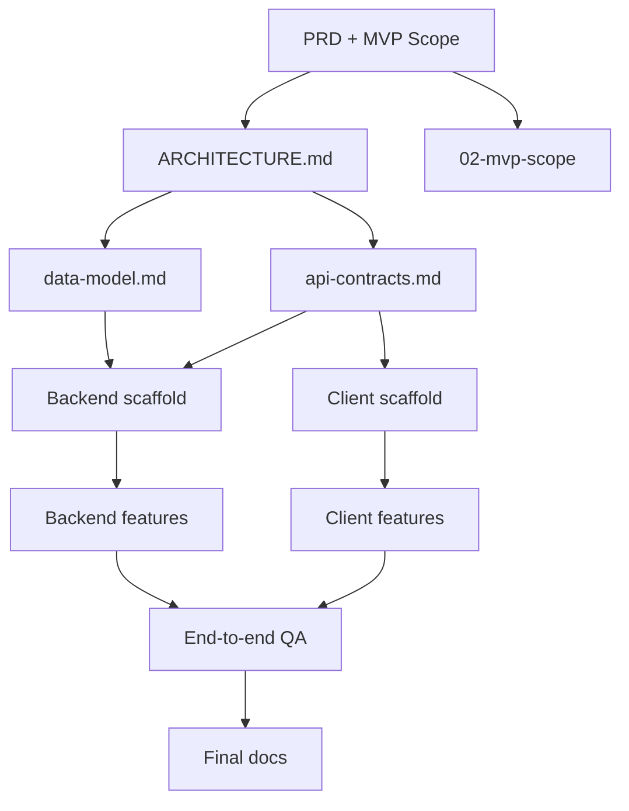

# Orchestration: how to direct the AI in this project

## Guiding principle

> You direct, the AI executes. But the AI can parallelize: use subagents when the task allows it.

---

## When to launch subagents

### Always parallelizable

Independent tasks, one subagent each:

| Task | Suggested subagent | Expected output |
|---|---|---|
| Research an unknown library/API/SDK | `explore` or `general` | Summary + examples + gotchas |
| Find an existing pattern in the codebase | `explore` (quick) | Files + line references |
| Audit several files against a criterion | `general` | Findings table |
| Generate unit tests for N independent modules | One subagent per module | Test files |
| Scaffold N independent features | One subagent per feature | Code + tests |
| Adversarial review | 2 blind subagents | Independent reviews |

### Parallelizable with care

| Task | Risk | Mitigation |
|---|---|---|
| Several writes to the same file | Conflict / race | Serialize or split the file |
| Several schema migrations | Order matters | Serialize |
| Backend + client for the same feature | API contract drift | Define the contract BEFORE parallelizing |

### Never parallelize

- **Refactors that change folder structure** — a parallel agent does not see the other's changes.
- **Architectural decisions** — they need shared context.
- **Debugging one bug** — sequential context is the tool.
- **Dependent implementation sessions** — respect the DAG.

---

## Task DAG

- Nodes at the same level can run in parallel.
- Arrows are blocking: do not start the next node before the previous one is done.

---

## Shared state between subagents

Subagents do NOT share context in real time. To coordinate:

1. **Before parallelizing**: the orchestrator writes one brief per subagent with ALL the context it needs.
2. **During**: each subagent works in isolation.
3. **After**: the orchestrator synthesizes outputs and resolves conflicts.

Useful patterns:
- Persistent memory for key decisions.
- Frontmatter `status: draft|active|done` to signal progress.
- The traceability table at the end of `02-mvp-scope.md`.

---

## Hard rules

1. **No client or server starts a feature without an up-to-date `api-contracts.md`.**
2. **Every in-scope feature has one spec, plus one ADR if it has a decision fork.** No spec, no build.
3. **Long sessions risk write timeouts.** Past ~50 tool calls, close the session with a summary and open a new one.
4. **The orchestrator does not write feature code.** It coordinates, synthesizes and decides.

---

## Checklist before each task

- [ ] Is this task IN SCOPE in `02-mvp-scope.md`?
- [ ] Are its DAG dependencies done?
- [ ] Can it run in parallel with another pending task?
- [ ] If it touches the API, is `api-contracts.md` up to date?
- [ ] If it touches persistence, is `data-model.md` up to date?
- [ ] Inline or subagent?
- [ ] Does it have a verifiable Definition of Done?

---

## Heuristic: inline or subagent?

| Estimated effort | Decision |
|---|---|
| < 5 min, < 3 files | inline |
| 5-30 min, bounded context | inline (can be long) |
| > 30 min OR > 5 files OR needs prior exploration | subagent |
| Needs web search / external docs | subagent |
| Repetitive over N items | N parallel subagents |
