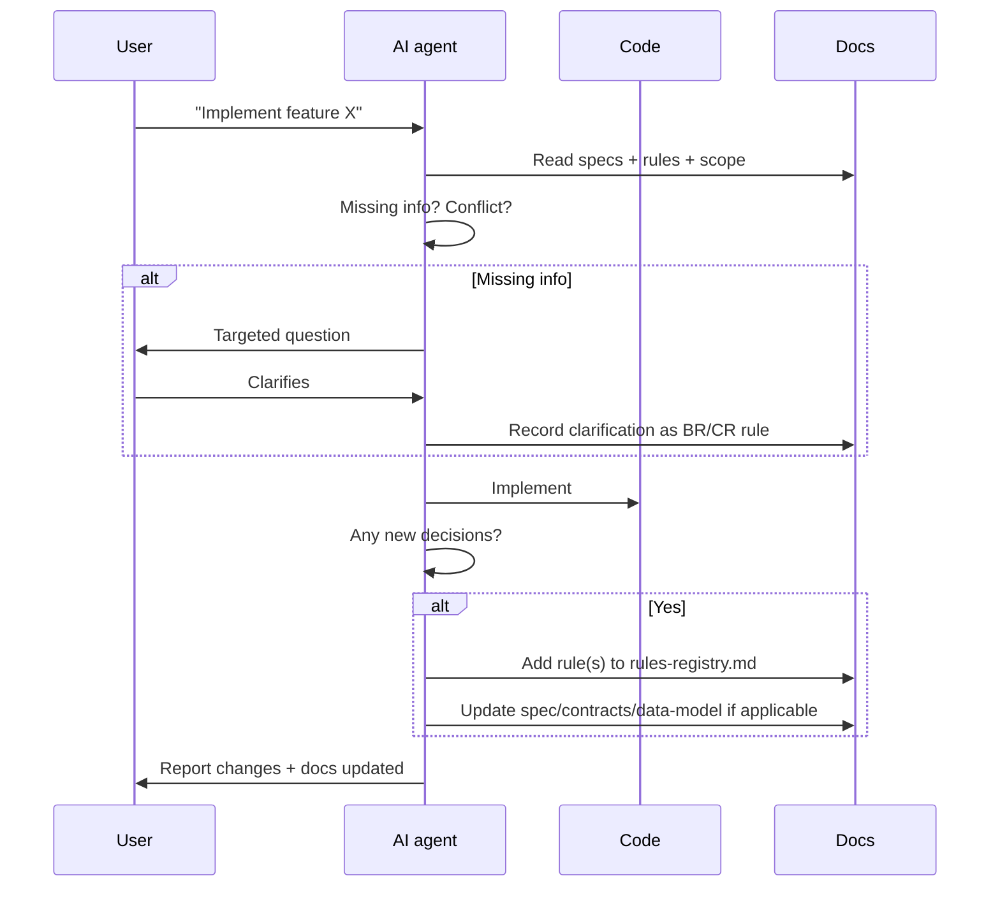

# Documentation Sync Protocol

Applies to this repository: `meeting-scribe`. Docs taxonomy: [`../README.md`](../README.md).

> **Guiding principle**: documentation is code. If the code changes, the docs change **in the same commit**, not later.

---

## Why this doc exists

Without explicit triggers, docs (specs, ADRs, schema) diverge from the code:
- No explicit "when to update" trigger
- No "what to update" checklist
- No drift verification
- Decisions made in AI sessions are not recorded in docs

The result: the AI builds something different from what is documented. This protocol prevents it.

---

## Update triggers (when)

Each action on the left **requires** updating the docs on the right. No exceptions.

| Code action | Docs to update | When |
|---|---|---|
| Add/modify a field in an entity | `architecture/data-model.md` (planned: not written yet; until then the entity code and `specs/processing.md` are the reference) | Same commit |
| Add/modify a D-Bus method, property or signal | `architecture/api-contracts.md` | Same commit |
| Change feature behavior | `specs/<feature>.md` | Same commit |
| Architectural decision with alternatives | new ADR | Before the code |
| Minor business or code decision | new entry in `project/rules-registry.md` | Same commit |
| Move a feature from "in scope" to "done" | `project/mvp-scope.md` (status + commit hash) | On merge |
| Discover a gotcha or anti-pattern | `project/rules-registry.md` (GO or AP) | Same day |
| Change a major dependency version | root `ARCHITECTURE.md` | Same commit |
| Change a dev/build/deploy command | matching `runbooks/` entry, `Tooling` section of `AGENTS.md` | Same commit |
| Add/modify a settings variable | `.env.example` + the configuration table in root `ARCHITECTURE.md` | Same commit |
| Add/modify an error class | `architecture/error-codes-catalog.md` | Same commit |
| Change an import-linter contract | root `ARCHITECTURE.md` (layering rules) | Same commit |
| Change `scripts/`, `packaging/`, `gnome-extension/` or `desktop-tray/` behavior | matching `runbooks/` entry, `README.md` (install and quickstart), root `ARCHITECTURE.md` (sections 2 and 6) | Same commit |
| Complete a task | `project/backlog.md` and the ODD feature document | Same commit |

---

## Integration PR docs gate

An integration (tracker) PR collects the work-unit PRs of a phase. Before it is reported to the owner as ready
to merge:

1. `make check` is green on the integration branch. It includes the drift tests in
   `tests/unit/test_docs_sync.py` (error codes, ADR table, import contracts, settings, links, phase status).
2. A read-only documentation audit runs against the integration branch. Scope: everything in `docs/`,
   `README.md`, `AGENTS.md`, `PRD.md`, `ARCHITECTURE.md` and `.env.example`. The report is evidence-based
   (file, line, what the code does instead) and graded P1 (wrong or misleading), P2 (stale or incomplete) or
   P3 (cosmetic).
3. Every P1 and P2 finding is fixed in a docs PR into the integration branch. P3 findings are optional.
4. A language scan finds no Spanish (including Rioplatense voseo) in code, identifiers, comments, UI strings,
   docs, commit messages or PR text. Spanish belongs only in the conversation with the owner. Test fixtures
   that deliberately exercise non-ASCII transcript text (for example "mañana") are allowed. A quick scan:
   `rg -l '[áéíóúñ¿¡]'` over the repository and `git log --format=%s <base>..HEAD`, then read each hit.
5. Only then is the tracker PR marked ready.

The drift tests catch mechanical drift only; the audit catches prose that no test can check.

---

## Triggers specific to AI sessions

Before ending a session, ask yourself:

| Did I do this? | Then do this BEFORE closing |
|---|---|
| Decide something undocumented? | Add a rule to `project/rules-registry.md` |
| Find a gotcha? | Add GO-XXX to the registry |
| Change a D-Bus member? | Update `architecture/api-contracts.md` |
| Add/modify a model? | Update `architecture/data-model.md` once it exists, else the relevant spec |
| Complete an in-scope feature? | Mark it done in `project/mvp-scope.md` with date + commit |
| The user stated a technical preference? | Add CR-XXX to the registry |
| Detect an anti-pattern from experience? | Add AP-XXX to the registry |
| The session made discoveries? | Write a session summary with a `Discoveries` section |

---

## Final checklist before commit / closing a session

```markdown
## Doc-sync checklist

- [ ] If I changed models: data-model.md updated (or the spec, while data-model.md is planned)
- [ ] If I changed the API: api-contracts.md updated
- [ ] If I decided something new: rule added to rules-registry.md
- [ ] If I completed an in-scope feature: mvp-scope.md updated
- [ ] If I discovered a gotcha: GO-XXX added
- [ ] If I made an architectural decision: ADR created
- [ ] Session summary written with discoveries and next steps
- [ ] `last_updated` frontmatter of touched docs updated
```

**If a box does not apply, mark it N/A explicitly.** Do not leave it empty.

---

## Update flow



---

## Drift detection

### Manual (any time)

```bash
git diff --name-only HEAD~5 | rg "models" && echo "-> is data-model.md updated?"
git diff --name-only HEAD~5 | rg "_interface" && echo "-> is api-contracts.md updated?"
```

### Periodic audit

Launch a subagent with a prompt such as:
> "Audit `docs/architecture/data-model.md` against the entities in `src/`. Report every inconsistency:
> fields in code not documented, documented fields that no longer exist, differing types."

---

## Rules for the AI: how NOT to break this protocol

### Anti-patterns

1. **"I will implement now and document later"** — No. Later never happens.
2. **"It is a small change, no doc needed"** — No. Twenty undocumented small changes make the system unintelligible.
3. **"I will update the docs in another commit"** — No. A change without docs is incomplete.
4. **"I will ask the user whether documenting is worthwhile"** — No. If it triggers a rule, document it.
5. **"I assume the user will document it"** — No. You have the fresh context.

### Correct patterns

1. **Before coding**: read `project/rules-registry.md`, filtered by the category you will touch.
2. **During**: note any decision you make so you can register it at the end.
3. **After**: run the final checklist ALWAYS, even if the session was short.
4. **If the user corrects you**: that correction is a candidate rule. Propose adding it to the registry.

---

## Message templates for the user

### When you add a new rule

```
Implementation complete.

Rules registered:
- BR-006: <description> — added to rules-registry.md
- GO-006: <description> — added to rules-registry.md

Docs updated:
- docs/architecture/data-model.md (field X added to Y)
- docs/specs/feature-z.md (AC-3 modified)
```

### When you detect drift you cannot fix alone

```
Drift detected between docs and code that needs your decision:

- data-model.md says `Meeting.status` is one of [recording, processing, done]
- code has [recording, processing, review, done]

Which is the source of truth? If it is the code, I update the doc.
If it is the doc, I refactor the code (and add an ADR if it is a new decision).
```

---

## Protocol health indicators

Working:

- `project/rules-registry.md` grows with the project (more than one new rule per active week)
- `project/mvp-scope.md` statuses are current (nothing "in progress" for over a month)
- Periodic audits find few inconsistencies
- New ADRs reference real decisions made in sessions

Breaking:

- Nobody adds rules for more than two weeks (yet there are commits)
- Specs marked `done` that nobody verifies
- Rules with status `active` whose source code no longer exists
- A new contributor (human or AI) asks questions whose answers are in the code but not in the docs
