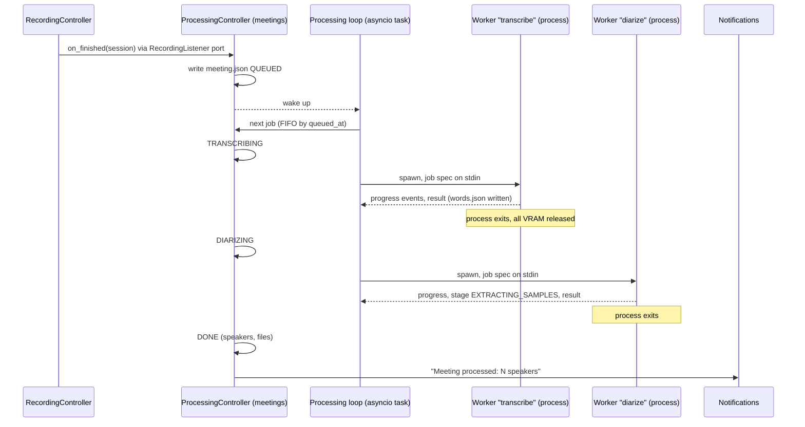
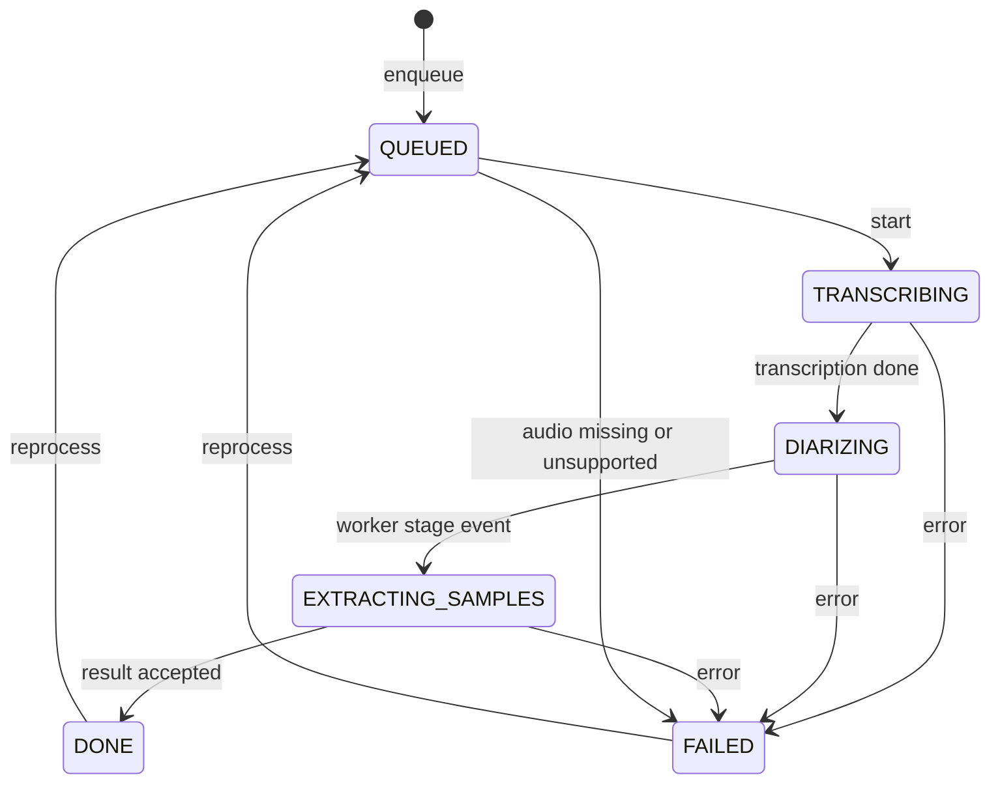

# Spec: Post-recording processing pipeline

## Goal (one sentence)

When a recording stops, the service turns its audio chunks, without any manual step, into a speaker-labelled
transcript with the user's own voice marked "Me", one voice sample per speaker, and a desktop notification, using
the GPU one job at a time and releasing it completely afterwards.

---

## Users / Personas

| Persona | How they use the feature |
|---|---|
| The developer (single user) | Stops a recording from the panel menu, keeps working, gets "Meeting processed: N speakers", then reviews speakers in F4 |

---

## User stories

- **US-1**: As the user, I want the meeting transcribed and diarized automatically after I stop, so that I do no manual steps.
- **US-2**: As the user, I want a desktop notification when processing ends (success or failure), so that I know when to review or what to fix.
- **US-3**: As the user, I want my own voice labelled "Me" automatically, also when I use loudspeakers, so that I never have to name myself.
- **US-4**: As the user, I want one short voice sample per speaker, so that the review app (F4) lets me tell who is who.
- **US-5**: As the user, I want processing to survive a service restart or crash, so that a meeting is never left half processed.
- **US-6**: As the user, I want the GPU fully free when processing is not running, so that my desktop and next meeting are not affected.
- **US-7**: As the user, I want the panel menu to show that a meeting is being processed.

---

## Acceptance criteria (Gherkin to tests)

Test paths are the planned locations; the task that builds each one is in [Task breakdown](#11-task-breakdown).

### AC-1: Stop enqueues a processing job

```gherkin
GIVEN a recording in progress whose folder holds at least one chunk with audio frames
WHEN the recording stops cleanly
THEN meeting.json exists in the meeting folder with processing.state QUEUED and schema_version 1
AND Meetings1 emits ProcessingStateChanged(id, "QUEUED")
```

**Test**: `tests/unit/meetings/test_processing_controller.py::test_stopped_recording_is_enqueued`

### AC-2: One job at a time, first in first out

```gherkin
GIVEN two meetings queued at 10:00 and 10:05
WHEN the queue runs
THEN the 10:00 meeting reaches DONE or FAILED before any worker starts for the 10:05 meeting
AND at most one worker process exists at any moment
```

**Test**: `tests/unit/meetings/test_processing_queue.py::test_jobs_run_one_at_a_time_in_queue_order`

### AC-3: States progress in order and are persisted

```gherkin
GIVEN a queued meeting and a fake worker that succeeds
WHEN the job runs
THEN processing.state goes QUEUED, TRANSCRIBING, DIARIZING, EXTRACTING_SAMPLES, DONE
AND each state is written to meeting.json before the matching ProcessingStateChanged signal
AND an out-of-order stage event from the worker fails the job with WORKER_PROTOCOL_ERROR
```

**Test**: `tests/unit/meetings/test_meeting.py::test_processing_transitions_follow_the_state_machine`

### AC-4: Resume at service start

```gherkin
GIVEN meeting A in QUEUED, meeting B in DIARIZING with a valid words.json, meeting C in DONE and meeting D in FAILED
WHEN the service starts
THEN A and B are re-enqueued in queued_at order and C and D are untouched
AND B does not re-run transcription (the words cache is valid) and resumes at diarization
```

**Test**: `tests/unit/meetings/test_processing_controller.py::test_resume_requeues_unfinished_jobs_only`

### AC-5: Caches are keyed on processing parameters and audio

```gherkin
GIVEN a words.json produced with TRANSCRIPTION_MODEL=large-v3-turbo and TRANSCRIPTION_LANGUAGE=es
WHEN a job runs with TRANSCRIPTION_LANGUAGE=auto
THEN the cache is rejected and transcription runs again
AND the same happens when the chunk list or any chunk frame count differs
```

**Test**: `tests/unit/transcription/test_words_cache.py::test_cache_is_invalid_when_params_or_audio_change`

### AC-6: Chunk offsets come from real frame counts

```gherkin
GIVEN chunks of 480 640, 480 320 and 12 000 frames at 16 kHz
WHEN the session timeline is built
THEN the chunk offsets are 0.0 s, 30.04 s and 60.06 s and the duration is 60.81 s
AND a chunk that is not 2-channel, 16 kHz, 16-bit fails the job with MEETING_AUDIO_UNSUPPORTED
```

**Test**: `tests/unit/meetings/test_chunk_timeline.py::test_offsets_use_frame_counts_not_indices`

### AC-7: Word to speaker assignment

```gherkin
GIVEN turns S1 [0.0, 2.0] and S2 [2.5, 5.0]
WHEN words [1.8, 2.2] and [2.3, 2.4] are assigned
THEN the first word goes to S1 (largest overlap)
AND the second goes to S2 (no overlap; its midpoint 2.35 s is nearest to S2's start)
AND with no turns at all every word goes to a single fallback "Speaker 1"
```

**Test**: `tests/unit/speakers/test_assignment.py::test_max_overlap_then_nearest_by_midpoint`

### AC-8: Utterance grouping

```gherkin
GIVEN consecutive words of S1 separated by gaps of 4.9 s and then 5.1 s
WHEN utterances are grouped with SPEAKERS_UTTERANCE_GAP_SECONDS=5.0
THEN the first two words form one utterance and the third starts a new one
AND a change of speaker always starts a new utterance
```

**Test**: `tests/unit/speakers/test_utterances.py::test_gap_threshold_splits_utterances`

### AC-9: Speaker numbering and transcript rendering

```gherkin
GIVEN pyannote labels SPEAKER_03 then SPEAKER_00 by first utterance, plus the user's turns
WHEN the transcript is rendered
THEN SPEAKER_03 is "Speaker 1", SPEAKER_00 is "Speaker 2" and the user's turns are "Me"
AND each utterance is one paragraph "[HH:MM:SS] **<name>:** <text>" with a blank line between paragraphs
AND a speaker with a name set in meeting.json is rendered with that name
```

**Test**: `tests/unit/speakers/test_transcript.py::test_renumber_by_first_appearance_and_render`

### AC-10: "Me" with a headset

```gherkin
GIVEN a synthetic 2-channel recording with a tone burst on channel 0 (mic) and silence on channel 1 (system)
WHEN "Me" detection runs with the default threshold
THEN the burst is a "Me" turn and no system speaker owns it
```

**Test**: `tests/unit/speakers/test_me_detection.py::test_mic_only_speech_is_me`

### AC-11: "Me" with loudspeaker bleed

```gherkin
GIVEN a synthetic recording where channel 1 carries a burst and channel 0 carries the same burst attenuated by 15 dB
WHEN "Me" detection runs
THEN no "Me" turn is produced for that burst
AND a later burst present only on channel 0 while channel 1 also plays is a "Me" turn (double talk)
```

**Test**: `tests/unit/speakers/test_me_detection.py::test_bleed_is_not_me_and_double_talk_is`

### AC-12: Voice samples

```gherkin
GIVEN speaker S1 with clean turns of 2 s, 9 s, 4 s and 1 s and one 6 s turn overlapping S2
WHEN samples are extracted with the defaults (3 clips, 15 s total, clips of 1.5 s to 6 s)
THEN samples/S1.wav is mono 16 kHz 16-bit, built from the 9 s, 4 s and 2 s turns (trimmed to 6 s, 4 s, 2 s)
AND clips are separated by 0.4 s of silence and the file lasts 12.8 s
AND the overlapping turn is never used
```

**Test**: `tests/unit/speakers/test_samples.py::test_longest_clean_turns_are_selected`

### AC-13: Worker crash and timeout

```gherkin
GIVEN a fake worker that exits with code -9 after one progress event
WHEN the job runs
THEN the job is FAILED with WORKER_CRASHED and a failure reason holding the exit code and the stderr tail
GIVEN a fake worker that never exits
WHEN the stage timeout elapses
THEN the worker gets SIGTERM, then SIGKILL after the grace period, and the job is FAILED with WORKER_TIMEOUT
```

**Test**: `tests/unit/meetings/test_subprocess_worker_runner.py::test_crash_and_timeout_fail_the_job`

### AC-14: Missing access to the diarization model is actionable

```gherkin
GIVEN no Hugging Face login, or the community-1 terms not accepted
WHEN the diarization stage loads the pipeline
THEN the job is FAILED with DIARIZATION_MODEL_ACCESS_DENIED and a message naming the model page and "hf auth login"
AND words.json is kept, so Reprocess after fixing the login skips transcription
AND the token is never read, logged or printed
```

**Test**: `tests/unit/speakers/test_pyannote_diarizer.py::test_gated_model_error_maps_to_access_denied` (fake loader)

### AC-15: No silent CPU fallback

```gherkin
GIVEN PROCESSING_DEVICE=cuda and no usable CUDA device
WHEN a GPU stage starts
THEN the job is FAILED with GPU_UNAVAILABLE and a message suggesting PROCESSING_DEVICE=cpu
AND nothing runs on the CPU
GIVEN PROCESSING_DEVICE=cpu
THEN the stages run on the CPU, meeting.json records the device used, and the log says so at WARNING
```

**Test**: `tests/unit/transcription/test_device_policy.py::test_cuda_required_never_falls_back`

### AC-16: Shutdown cancels the worker and the job resumes

```gherkin
GIVEN a job in TRANSCRIBING with a running worker
WHEN the service receives SIGTERM
THEN the worker is terminated (SIGTERM, then SIGKILL after the grace period) before the service exits
AND meeting.json still says TRANSCRIBING, so the job resumes at the next start
```

**Test**: `tests/unit/meetings/test_processing_queue.py::test_shutdown_terminates_worker_and_keeps_job_resumable`

### AC-17: No GPU work while recording (OQ-3)

```gherkin
GIVEN a job in DIARIZING with a running worker
WHEN a new recording starts
THEN the worker is terminated and the job returns to the queue head in its current state
AND no worker starts until the recording stops
```

**Test**: `tests/unit/meetings/test_processing_queue.py::test_recording_preempts_gpu_work`

### AC-18: Desktop notification

```gherkin
GIVEN a job that ends DONE with 3 speakers (including "Me")
THEN the service sends one notification "Meeting processed: 3 speakers" through org.freedesktop.Notifications
GIVEN a job that ends FAILED
THEN the notification says "Meeting processing failed" with the short failure reason
AND a notification service error is logged at WARNING and never changes the job state
AND no notification ever contains transcript text
```

**Test**: `tests/unit/meetings/test_processing_controller.py::test_notification_on_finish_never_fails_the_job`

### AC-19: Meetings1 over D-Bus

```gherkin
GIVEN a private bus and a fake meeting repository holding two meetings
WHEN a client calls List
THEN it gets both meetings, newest first, with id, started_at, duration, processing state and speaker count
WHEN it calls Get with an unknown id
THEN it gets dev.meetingscribe.Error.ENTITY_NOT_FOUND_MEETING
WHEN a job finishes
THEN ProcessingFinished(id, state, speaker_count) is emitted
```

**Test**: `tests/e2e/meetings/test_meetings_over_dbus.py`

### AC-20: The service process never loads ML libraries

```gherkin
GIVEN the import-linter contracts
WHEN make imports runs
THEN meeting_scribe.main imports none of torch, torchaudio, faster_whisper, ctranslate2, pyannote
```

**Test**: `make imports` (new forbidden contract "The service never imports ML libraries")

---

## What this is NOT (out of scope for this spec)

- Not live transcription during the meeting (ADR-003, IDEA-001).
- Not the review app (rename, merge, playback): F4. This spec only produces what F4 consumes (speakers list, samples, utterances).
- Not summaries: F5.
- Not parallel jobs or multi-GPU.
- Not speaker identity across meetings (no voice enrolment, no embeddings database).
- Not automatic processing of folders created by the old prototype or folders without `meeting.json` (see OQ-2).
- Not a progress bar: the extension shows the stage name only (percentage is a possible follow-up).

---

## Edge cases

| Case | Expected behavior |
|---|---|
| Recording stopped with no chunk or only 0-frame chunks | Job FAILED with `MEETING_AUDIO_MISSING`; notification says so |
| Recording ended `FAILED` (capture crash) with chunks on disk | Enqueued like a clean stop (OQ-1) |
| Last chunk truncated by a crash (header frame count wrong or zero) | Frames recovered from the file size (`(size - header) // block_align`); logged at WARNING |
| Gap in chunk indices (`chunk_00003.wav` missing) | Chunks are concatenated in index order, a WARNING names the missing index; timing stays frame-exact for the chunks present |
| Chunk is mono, another sample rate or not 16-bit (prototype folder) | Job FAILED with `MEETING_AUDIO_UNSUPPORTED` |
| Silence only, or Whisper returns no words | DONE with 0 speakers; `transcript.md` holds "(no speech detected)"; notification "Meeting processed: no speech detected" |
| Diarization returns no turns but words exist | Words go to a single fallback "Speaker 1" (the prototype crashed on `max()` of an empty list) |
| System channel silent for the whole meeting (in-person meeting, only the mic) | Diarize the mic channel and skip "Me" (OQ-4) |
| No microphone (mic channel is silence) | No "Me" turns; diarization unaffected |
| A remote participant's echo of the user appears on the system channel | Inside "Me" turns the mic decision wins; a leftover small cluster can be merged in F4 |
| Another person in the room speaks into the user's microphone | Labelled "Me" (known limitation; the dominance rule cannot tell two local voices apart) |
| Speaker found by diarization but owning no word | Not listed in `speakers` and not counted; logged at DEBUG with its talk time |
| Speaker with no clean turn of at least 1.5 s | No sample; `speakers[].sample` is the empty string; F4 shows "no sample" |
| `meeting.json` `schema_version` newer than the service supports | Meeting listed with state `UNSUPPORTED`; never processed or rewritten (`MEETING_SCHEMA_UNSUPPORTED` on Get) |
| Corrupt `meeting.json` | Logged at ERROR, meeting skipped by List and resume; the file is never overwritten |
| Settings changed between a crash and the resume | Caches whose key differs are rejected; the stage re-runs with the new settings (AC-5) |
| Worker writes unexpected text to stdout (library print, progress bar) | Impossible by construction: the worker moves file descriptor 1 to stderr before importing any library (see 6.2) |
| Very long meeting (4 h) | Works; worker peak RAM about 1 GB of audio plus the model (see 2.3) |
| HF model not in cache and no network | Job FAILED with `MODEL_UNAVAILABLE`, message names the model and the cache path (never the token) |
| GPU out of memory | Job FAILED with `GPU_OUT_OF_MEMORY`; no automatic CPU retry (AC-15) |
| Reprocess requested while the job is queued or running | Refused with `MEETING_PROCESSING_ACTIVE` |

---

## Technical design

### 1. Pipeline after Stop



**Hand-off from recording.** `recording` cannot import `meetings` (CR-001). The recording domain gets a
`RecordingListener` port (`on_started(session)`, `on_finished(session)`), injected into `RecordingController` by the
composition root, which adapts it to `ProcessingController.enqueue(...)` and `ProcessingController.preempt()`.
`on_finished` fires after a clean stop (`STOPPED`) and, per OQ-1, after a `FAILED` session. It runs on the
controller's worker thread (GO-024), so it only persists `meeting.json` and wakes the loop with
`loop.call_soon_threadsafe`.

**Job state machine** (entity methods on `Meeting`, returning `model_copy`, `now` passed in, CR-006):



| State | Covers | Runs in |
|---|---|---|
| `QUEUED` | Waiting for the single worker slot | service |
| `TRANSCRIBING` | Mix both channels, Whisper with word timestamps, `words.json` | worker process 1 |
| `DIARIZING` | System channel through pyannote (`turns.json`), "Me" detection, word assignment, utterances | worker process 2 |
| `EXTRACTING_SAMPLES` | Voice samples, `utterances.json`, `transcript.md` | worker process 2 (after pyannote is released) |
| `DONE` / `FAILED` | Terminal until Reprocess | service |

A preempted or shut-down job keeps its current state on disk; "in progress" (`TRANSCRIBING`, `DIARIZING`,
`EXTRACTING_SAMPLES`) means "resume from here". Resume re-enqueues every `QUEUED` and in-progress meeting in
`queued_at` order. A resumed job always restarts with the transcribe worker: each worker checks its cache first and
returns in about a second when the cache is valid, so "re-run from the last completed stage" needs no extra
bookkeeping beyond the caches (section 4).

**`meeting.json`, schema version 1.** Only the service writes it (single writer), atomically (temp file plus
`os.replace`, ADR-004). Workers write only their own artifact files.

```json
{
  "schema_version": 1,
  "id": "2026-10-09_101500",
  "recording": {"started_at": "2026-10-09T10:15:00+02:00", "stopped_at": "2026-10-09T11:10:02+02:00",
                "state": "STOPPED", "failure_reason": ""},
  "processing": {
    "state": "DONE",
    "queued_at": "...", "started_at": "...", "finished_at": "...",
    "attempt": 1,
    "failure": null,
    "device": {"transcription": "cuda/float16", "diarization": "cuda"},
    "params": {"transcription": {"model": "large-v3-turbo", "language": "es", "...": "..."},
               "speakers": {"pipeline": "pyannote/speaker-diarization-community-1", "...": "..."}},
    "detected_language": "es",
    "audio": {"chunk_count": 111, "total_frames": 52832640, "duration_seconds": 3302.04}
  },
  "speakers": [
    {"id": "ME", "label": "Me", "name": "", "is_me": true, "talk_seconds": 610.2, "utterance_count": 48,
     "sample": "samples/ME.wav"},
    {"id": "S1", "label": "Speaker 1", "name": "", "is_me": false, "talk_seconds": 1204.9,
     "utterance_count": 77, "sample": "samples/S1.wav"}
  ],
  "files": {"words": "words.json", "turns": "turns.json", "utterances": "utterances.json",
            "transcript": "transcript.md", "log": "processing.log"}
}
```

`failure` is `{"stage": "...", "error_code": "...", "message": "..."}` when `FAILED`. Paths are relative to the
meeting folder. `name` is empty until F4. Unknown keys are preserved on rewrite (forward compatibility).

**Meeting folder** after processing (ADR-004): `meeting.json`, `audio/chunk_NNNNN.wav`, `ffmpeg.log`, `words.json`,
`turns.json`, `utterances.json`, `transcript.md`, `samples/<speaker id>.wav`, `processing.log` (worker stderr; never
transcript text).

### 2. Audio handling

#### 2.1 Input format and timeline

Chunks are `audio/chunk_NNNNN.wav`: 2 channels (channel 0 microphone, channel 1 system, ADR-002, GO-019), 16 kHz,
signed 16-bit PCM, about 30 s each but never exactly (GO-018). They are decoded with stdlib `wave` plus numpy, never
PyAV (GO-003). A pure domain function builds the **timeline** from the frame count in each header:
`offset_i = sum(frames_0 .. frames_{i-1}) / 16000`. The prototype used `index * 30 s` (GO-013). The same pass
validates the format (channels, rate, width) and computes the **audio fingerprint** used by the caches:
`[(file name, frames, size in bytes), ...]`.

#### 2.2 Which signal goes where

| Use | Signal | Why |
|---|---|---|
| Transcription | Mean of both channels, `(ch0 + ch1) / 2`, float32 in [-1, 1] | Whisper must hear everyone; the mean cannot clip (the prototype's `amix normalize=0` summed). Whisper normalizes the log-mel input, so the 6 dB level drop does not matter (assumption A-6) |
| Diarization | Channel 1 (system) only | ADR-002: remote voices are on the system channel; the conferencing app's echo cancellation keeps the user's own voice out of it, so pyannote separates remote participants without the user and without loudspeaker bleed. Diarizing the mix would bring back the over-splitting seen in the prototype (GO-009) and loses who is who |
| "Me" detection | Energy of channel 0 versus channel 1 per frame | ADR-002: decided per turn by energy dominance, never by blind channel assignment |
| Voice samples | Channel 1 for remote speakers, channel 0 for "Me" | Each is the cleanest source of that voice |

#### 2.3 Memory budget: whole signal per stage, no streaming

A float32 mono signal costs 16 000 x 4 B = 64 KB per second, about **230 MB per hour**. Each worker builds only the
signal its stage needs, decoding chunk by chunk into one **preallocated** array sized from the timeline (no
`np.concatenate`, which would double the peak). The transcribe worker holds the mix; the diarize worker holds the
system channel (shared with torch through `torch.from_numpy`, no copy) plus per-frame energies (100 ms frames, two
float64 values per frame, under 1 MB per hour; computed in 1.6 MB blocks, never from a whole-signal float64 copy).
Peak audio memory is therefore about 230 MB per recorded hour per worker, about 1 GB for a 4-hour meeting.

Streaming (windowed Whisper, chunked diarization) is rejected: Whisper and pyannote both work best on the whole
session (ADR-003 Option C: "whole-session processing gives the best quality"), pyannote clusters speakers globally,
and the measured budget is affordable. Revisit if meetings longer than 4 hours become common.

#### 2.4 "Me" detection by per-frame energy dominance

A pure function in `speakers/domain/` turns two energy envelopes into "Me" turns. Frames are 100 ms; `E_mic` and
`E_sys` are mean squares per frame.

1. **Noise floors**: `N_mic`, `N_sys` = 10th percentile of each envelope.
2. **Bleed coefficient** `k`: over frames where the system is clearly active (`E_sys >= N_sys * 10^(SPEAKERS_ME_NOISE_MARGIN_DB/10)`), `k` =
   median of `E_mic / E_sys`, clamped to [0, 1]. With a headset `k` is about 0; with loudspeakers it estimates how
   much system audio reaches the microphone. The median is robust because the user is silent during most remote
   speech. With fewer than 30 s of active system frames, `k` = 0.
3. **Residual**: `R = max(E_mic - k * E_sys, 0)`, the mic energy not explained by bleed.
4. **Me frame**: `R >= N_mic * 10^(SPEAKERS_ME_NOISE_MARGIN_DB/10)` and
   `10 * log10(R / (k * E_sys + N_mic)) >= SPEAKERS_ME_DOMINANCE_DB`.
5. **Turns**: merge Me frames separated by at most 0.3 s; drop turns shorter than `SPEAKERS_ME_MIN_TURN_SECONDS`.
6. **Unknown** (ADR-002 accepted trade-off): a stretch where `R` is above the noise margin for at least the minimum
   turn length, that fails the dominance test and overlaps no system turn, becomes an `UNKNOWN` turn ("Unknown" in
   the transcript) instead of a guess.
7. **Merge with diarization**: system turns come from pyannote's exclusive diarization. Where a "Me" turn overlaps a
   system turn, "Me" wins for the overlap and the system turn is cut around it, so the combined turn list stays
   exclusive (one speaker per instant), which is what word assignment needs.

Defaults (`SPEAKERS_ME_DOMINANCE_DB=6.0`, noise margin 10 dB, minimum turn 0.5 s) are a starting point. One real
recording processed to DONE with them; headset and loudspeaker setups are not compared yet, so they stay as the
defaults (assumption A-7). Fixtures are synthetic tones and noise
(AC-10, AC-11).

### 3. Algorithms ported from the prototype (pure, tested domain functions)

All live in `speakers/domain/` (except the timeline, which lives in `meetings/domain/`), take plain value objects
and return new ones, and touch no files; only "Me" detection needs numpy arrays.

| Function | Rule | Prototype difference |
|---|---|---|
| `assign_speakers(words, turns)` | For each word: the turn with the largest positive overlap `min(ends) - max(starts)`; if none overlaps, the turn whose nearest edge is closest to the word midpoint; ties go to the earlier turn. No turns: every word gets the fallback speaker | The prototype crashed on an empty turn list |
| `group_utterances(words, max_gap)` | Same speaker and `word.start - utterance.end <= max_gap` extends the utterance; otherwise a new one starts. `max_gap` = `SPEAKERS_UTTERANCE_GAP_SECONDS` (5.0) | Gap was hard-coded |
| `number_speakers(utterances)` | Diarization labels become `S1..SN` by first utterance (not first turn), so numbers have no gaps; `ME` and `UNKNOWN` are never numbered | Numbered by first turn, so a speaker without words could take number 1 |
| `render_transcript(utterances, speakers)` | `[HH:MM:SS] **<name or label>:** <text>`, paragraphs separated by one blank line; labels `Speaker N`, `Me`, `Unknown` (English artifacts); `HH` always two digits | Label was "Interlocutor N"; names parsed from a comma-split CLI string |
| `build_timeline(chunk_headers)` | Offsets from frame counts (section 2.1) | `index * 30` |
| `select_sample_clips(turns, overlaps, params)` | Section 5 | New |

`format_timestamp(seconds)` truncates to whole seconds (`int(seconds)`), as in the prototype.

### 4. Caches keyed on processing parameters

| Artifact | Written by | Key |
|---|---|---|
| `words.json` | transcribe worker | transcription params (`model`, `language`, `compute_type`, `device`, `beam_size`, `vad_filter`, `condition_on_previous_text`, `word_timestamps`), engine versions (`faster-whisper`, `ctranslate2`), audio fingerprint |
| `turns.json` | diarize worker | `pipeline`, `num_speakers`, `min_speakers`, `max_speakers`, `device`, `pyannote.audio` version, diarized channel, audio fingerprint |

Each cache file is `{"cache_version": 1, "key": {...}, "data": ...}`, written atomically, `ensure_ascii=False`. A
cache is used only when its `key` is equal to the key of the current job; otherwise it is ignored and overwritten
(GO-012: the prototype reused `words.json` whatever the params, and `--redo` did not even clear it). `turns.json`
stores both pyannote annotations (regular, with overlaps, for sample selection; exclusive, for assignment) plus `k`
and the "Me" and "Unknown" turns. Assembly (assignment, grouping, numbering, rendering, samples) is cheap and never
cached: it re-runs whenever the diarize worker runs, so changing `SPEAKERS_UTTERANCE_GAP_SECONDS` or the "Me"
thresholds takes effect on Reprocess without re-running any model.

### 5. Voice samples for the review app

For every listed speaker, `select_sample_clips` picks **clean turns**: turns from the regular (non-exclusive)
diarization that overlap no other speaker; for "Me", Me turns during which the system channel is below its activity
threshold. It takes the longest first, at most `SPEAKERS_SAMPLE_MAX_CLIPS` (3) clips, each at least
`SPEAKERS_SAMPLE_MIN_CLIP_SECONDS` (1.5 s) long and trimmed to its first `SPEAKERS_SAMPLE_MAX_CLIP_SECONDS` (6 s),
stopping once the total reaches `SPEAKERS_SAMPLE_TARGET_SECONDS` (15 s); the last clip is shortened so the total
never exceeds the target. Clips are
joined with 0.4 s of silence into `samples/<speaker id>.wav`, mono, 16 kHz, 16-bit, peak-normalized to -3 dBFS so
quiet speakers are audible. The source channel follows section 2.2. A speaker with no eligible turn gets no sample.

### 6. GPU policy and worker processes (ADR-007)

#### 6.1 Process model

The service process never imports `torch`, `torchaudio`, `faster_whisper`, `ctranslate2` or `pyannote` (enforced by
a new import-linter contract, AC-20). GPU work runs in **short-lived worker processes**, one per GPU stage of a job:

| Invocation | Loads | Produces | Then |
|---|---|---|---|
| `python -m meeting_scribe.worker transcribe` | faster-whisper (CTranslate2) | `words.json` | exits |
| `python -m meeting_scribe.worker diarize` | pyannote (torch) | `turns.json`, `utterances.json`, `transcript.md`, `samples/` | releases the pipeline, extracts samples on the CPU, exits |

Process exit returns all GPU memory (allocations, caching allocators and the CUDA context) to the driver; `del` plus
`torch.cuda.empty_cache()` does not (see [ADR-007](../decisions/007-gpu-worker-subprocess.md)). One process per
stage, rather than one per job, guarantees that Whisper and pyannote are never resident together without relying on
CTranslate2 releasing its memory on `del` (assumption A-2). The extra cost is one interpreter and CUDA start per job
(assumption A-3: a few seconds against minutes of processing).

`meeting_scribe/worker.py` is a second composition root next to `main.py`: it builds the transcription or speakers
adapters, and calls a `meetings` application use case (`run_transcribe_stage`, `run_diarize_stage`) through ports, so
the stage logic is testable with fakes. It reads no settings and no `.env`: everything comes in the job spec, so the
service is the single source of configuration. Import contract 6 is extended to `meeting_scribe.worker`.

The service spawns it with `asyncio.create_subprocess_exec(sys.executable, "-m", "meeting_scribe.worker", stage,
stdin=PIPE, stdout=PIPE, stderr=<processing.log>, start_new_session=True)`. `multiprocessing` with the spawn method
is rejected: it re-imports the parent's main module, pickles arguments, and does not integrate with the asyncio loop
as cleanly as a plain child process with pipes.

#### 6.2 Worker protocol (version 1)

**In**: one JSON object on stdin, then stdin is closed.

```json
{"protocol": 1, "stage": "transcribe", "meeting_dir": "/abs/path", "device": "cuda",
 "transcription": {"model": "large-v3-turbo", "language": "es", "compute_type": "float16",
                   "cpu_compute_type": "int8", "beam_size": 5, "vad_filter": true,
                   "condition_on_previous_text": false},
 "speakers": {"pipeline": "pyannote/speaker-diarization-community-1", "num_speakers": null,
              "min_speakers": null, "max_speakers": null, "utterance_gap_seconds": 5.0,
              "me_dominance_db": 6.0, "me_noise_margin_db": 10.0, "me_min_turn_seconds": 0.5,
              "sample_max_clips": 3, "sample_target_seconds": 15.0, "sample_min_clip_seconds": 1.5,
              "sample_max_clip_seconds": 6.0}}
```

**Out**: JSON lines on stdout, one object per line, flushed per line; the event name is in the `event` key (for example `{"event": "progress", ...}`):

| Event | Fields | Meaning |
|---|---|---|
| `started` | `pid`, `device` (effective, for example `cuda/float16`) | Model about to load |
| `cache_hit` | `artifact` | Valid cache found; the model is not loaded |
| `progress` | `stage`, `processed_seconds`, `total_seconds` | Throttled to at most one per second |
| `stage` | `state` (`EXTRACTING_SAMPLES`) | Diarize worker moved past pyannote |
| `result` | `artifacts`, `speakers`, `detected_language`, `audio` | Success; artifacts already written atomically |
| `error` | `error_code`, `message` | Handled failure; exit code 1 follows |

Exit code 0 requires a `result` event; 1 requires an `error` event. Anything else (a signal, a non-JSON line, a
missing final event, an unknown event, an out-of-order `stage`) is `WORKER_CRASHED` or `WORKER_PROTOCOL_ERROR`, with
the exit code and the tail of `processing.log` as the reason (the GO-021 pattern). Before importing any library the
worker duplicates file descriptor 1 for its event stream and points descriptor 1 at stderr (`os.dup2`), so a stray
`print` or progress bar from a library can never corrupt the protocol. Worker logs go to stderr (appended to
`processing.log` in the meeting folder) and contain ids, stages, timings and error codes, never transcript text.

**Environment** set by the service for the child: `HF_HUB_DISABLE_TELEMETRY=1` and pyannote's metrics opt-out
(the exact variable is confirmed in F3.3, assumption A-8). The Hugging Face token is never passed: the worker uses the
ambient login in the Hugging Face cache (GO-004).

#### 6.3 Timeouts, cancellation and preemption

- **Stage timeout**: `max(PROCESSING_WORKER_MIN_TIMEOUT_SECONDS, audio_seconds * PROCESSING_WORKER_TIMEOUT_FACTOR)`;
  defaults 900 s and 1.0 (real time), generous against the measured 0.055x real time on the GPU and still bounded on
  the CPU. On expiry: SIGTERM to the worker's process group, `PROCESSING_WORKER_KILL_GRACE_SECONDS` (5 s), then
  SIGKILL, then `WORKER_TIMEOUT`. Kill by PID or process-group id, never by pattern (GO-007).
- **Service shutdown** (SIGTERM, bus loss): after the recording is stopped (existing behaviour), the loop terminates
  the worker the same way and leaves the job in its in-progress state for resume (AC-16). The worst case (14 s
  recording stop plus 7 s worker stop) fits systemd's default 90 s stop timeout; `KillMode=mixed` then reaps any
  leftover process in the unit's cgroup.
- **Preemption** (OQ-3, approved; following ADR-003 "no GPU work during recording"): `on_started` terminates a running
  worker and puts its job back at the head of the queue; the loop starts no worker while a recording is active.

#### 6.4 Device policy, CUDA libraries, CPU fallback

- `PROCESSING_DEVICE=cuda` (default; OQ-5, approved): a GPU stage that finds no usable CUDA device fails with
  `GPU_UNAVAILABLE`. Nothing falls back silently (GO-011).
- `PROCESSING_DEVICE=cpu`: both stages run on the CPU (`TRANSCRIPTION_CPU_COMPUTE_TYPE`, default `int8`); logged at
  WARNING and recorded in `processing.device`; the notification says "(CPU)".
- Only errors that mean "no CUDA device or driver" map to `GPU_UNAVAILABLE`; out-of-memory maps to
  `GPU_OUT_OF_MEMORY`; anything else to `TRANSCRIPTION_FAILED` or `DIARIZATION_FAILED`. The prototype fell back to
  the CPU on any exception.
- **CUDA library preload** (GO-001): before importing `faster_whisper`, the transcribe worker loads every
  `site-packages/nvidia/*/lib/*.so*` with `ctypes.CDLL` and logs each failure at WARNING with the library name (the
  prototype swallowed `OSError`). faster-whisper's README documents the alternative of setting `LD_LIBRARY_PATH` to
  the `nvidia.cublas` and `nvidia.cudnn` lib directories; since the worker is a child process the service could set it
  in the child environment instead, if the preload proves fragile.
- torch (cu130, from pyannote) and CTranslate2 (cu12 libraries) never share a process anymore, which removes the
  GO-002 coexistence concern from the product (it stays true and harmless).

### 7. Settings

Each class inherits `MeetingScribeSettings`, lives in its domain's `infrastructure/`, and is composed into
`Settings` by the root. The service turns them into the job spec; the worker reads no settings.

| Variable | Class | Default | Meaning |
|---|---|---|---|
| `TRANSCRIPTION_MODEL` | `TranscriptionSettings` | `large-v3-turbo` | faster-whisper model name or path |
| `TRANSCRIPTION_LANGUAGE` | `TranscriptionSettings` | `es` | ISO code, or `auto` (detected from the first 30 s) |
| `TRANSCRIPTION_COMPUTE_TYPE` | `TranscriptionSettings` | `float16` | CTranslate2 compute type on CUDA |
| `TRANSCRIPTION_CPU_COMPUTE_TYPE` | `TranscriptionSettings` | `int8` | Compute type when `PROCESSING_DEVICE=cpu` |
| `TRANSCRIPTION_BEAM_SIZE` | `TranscriptionSettings` | `5` | Beam size (>= 1) |
| `TRANSCRIPTION_VAD_FILTER` | `TranscriptionSettings` | `true` | Silero VAD pre-filter |
| `TRANSCRIPTION_CONDITION_ON_PREVIOUS_TEXT` | `TranscriptionSettings` | `false` | Prototype value; avoids repetition loops on long audio |
| `SPEAKERS_PIPELINE` | `SpeakersSettings` | `pyannote/speaker-diarization-community-1` | pyannote pipeline id |
| `SPEAKERS_NUM_SPEAKERS` | `SpeakersSettings` | unset | Exact remote speaker count, or unset for automatic |
| `SPEAKERS_MIN_SPEAKERS` / `SPEAKERS_MAX_SPEAKERS` | `SpeakersSettings` | unset | Bounds when the count is automatic |
| `SPEAKERS_UTTERANCE_GAP_SECONDS` | `SpeakersSettings` | `5.0` | Same-speaker gap that still joins an utterance |
| `SPEAKERS_ME_DOMINANCE_DB` | `SpeakersSettings` | `6.0` | Residual mic energy over predicted bleed plus noise needed for "Me" |
| `SPEAKERS_ME_NOISE_MARGIN_DB` | `SpeakersSettings` | `10.0` | Margin over a channel's noise floor that counts as speech or activity: the mic residual for "Me", and the system channel for the bleed estimate, the in-person decision and quiet-system samples |
| `SPEAKERS_ME_MIN_TURN_SECONDS` | `SpeakersSettings` | `0.5` | Shortest "Me" turn kept |
| `SPEAKERS_SAMPLE_MAX_CLIPS` | `SpeakersSettings` | `3` | Clips per speaker sample |
| `SPEAKERS_SAMPLE_TARGET_SECONDS` | `SpeakersSettings` | `15.0` | Target total sample length |
| `SPEAKERS_SAMPLE_MIN_CLIP_SECONDS` / `SPEAKERS_SAMPLE_MAX_CLIP_SECONDS` | `SpeakersSettings` | `1.5` / `6.0` | Clip length bounds |
| `PROCESSING_DEVICE` | `ProcessingSettings` | `cuda` | `cuda` or `cpu`; no automatic fallback (OQ-5, approved) |
| `PROCESSING_WORKER_TIMEOUT_FACTOR` | `ProcessingSettings` | `1.0` | Stage timeout as a multiple of the audio length |
| `PROCESSING_WORKER_MIN_TIMEOUT_SECONDS` | `ProcessingSettings` | `900` | Lower bound of the stage timeout |
| `PROCESSING_WORKER_KILL_GRACE_SECONDS` | `ProcessingSettings` | `5` | SIGTERM to SIGKILL grace |
| `PROCESSING_STORAGE_RETRY_DELAYS_SECONDS` | `ProcessingSettings` | `[2, 8, 30]` | Delay before each retry after a storage failure (JSON list) |
| `PROCESSING_NOTIFY` | `ProcessingSettings` | `true` | Send desktop notifications |

All numeric settings are validated (`gt`/`ge`), and an invalid value fails at load, like `RECORDING_*`.

### 8. D-Bus `dev.meetingscribe.Meetings1` (implemented, F3.4a)

Same bus name and object path as `Recording1` (CR-011). The contract lives in
[`api-contracts.md`](../architecture/api-contracts.md).

| Member | Kind | Signature | Description | Errors |
|---|---|---|---|---|
| `List` | method | `() -> a(ssdsi)` | `(id, started_at, duration_seconds, processing_state, speaker_count)`, newest first | `MEETING_STORAGE_FAILED` |
| `Get` | method | `(s) -> a{sv}` | Keys: `id`, `started_at`, `duration_seconds`, `directory`, `processing_state`, `failure_code`, `failure_reason`, `speaker_count`, `transcript_path`; absent values are empty strings | `ENTITY_NOT_FOUND_MEETING`, `MEETING_SCHEMA_UNSUPPORTED` |
| `Reprocess` | method | `(s) -> s` | Re-enqueue a `DONE` or `FAILED` meeting; returns the state (`QUEUED`). Valid caches are reused | `ENTITY_NOT_FOUND_MEETING`, `MEETING_PROCESSING_ACTIVE` |
| `ActiveMeetingId` | property | `s` | Meeting being processed; empty when idle | — |
| `ActiveState` | property | `s` | `IDLE` or the active job's state | — |
| `QueuedCount` | property | `u` | Jobs waiting | — |
| `ProcessingStateChanged` | signal | `(ss)` | `(id, state)` on every transition | — |
| `ProcessingFinished` | signal | `(ssi)` | `(id, state, speaker_count)` with state `DONE` or `FAILED` (count 0) | — |

`PropertiesChanged` is emitted for the three properties. `Reprocess` is the retry path for an actionable failure
(AC-14); it is included because a `FAILED` job has no other way back (see OQ-6).

**New error codes** (registered in the [catalog](../architecture/error-codes-catalog.md) by the task that adds them):

| Class | `error_code` | Package |
|---|---|---|
| `EntityNotFoundError(detail_code="MEETING")` | `ENTITY_NOT_FOUND_MEETING` | meetings |
| `MeetingStorageError` | `MEETING_STORAGE_FAILED` | meetings |
| `MeetingCorruptError` | `MEETING_CORRUPT` | meetings |
| `MeetingSchemaUnsupportedError` | `MEETING_SCHEMA_UNSUPPORTED` | meetings |
| `MeetingProcessingActiveError` (subclass of `InvalidStateTransitionError`) | `MEETING_PROCESSING_ACTIVE` | meetings |
| `MeetingAudioMissingError` | `MEETING_AUDIO_MISSING` | meetings |
| `MeetingAudioUnsupportedError` | `MEETING_AUDIO_UNSUPPORTED` | meetings |
| `WorkerCrashedError` | `WORKER_CRASHED` | meetings |
| `WorkerTimeoutError` | `WORKER_TIMEOUT` | meetings |
| `WorkerProtocolError` | `WORKER_PROTOCOL_ERROR` | meetings |
| `GpuUnavailableError` | `GPU_UNAVAILABLE` | base (shared by two domains) |
| `GpuOutOfMemoryError` | `GPU_OUT_OF_MEMORY` | base |
| `ModelUnavailableError` | `MODEL_UNAVAILABLE` | base |
| `TranscriptionError` | `TRANSCRIPTION_FAILED` | transcription |
| `DiarizationError` | `DIARIZATION_FAILED` | speakers |
| `DiarizationModelAccessError` | `DIARIZATION_MODEL_ACCESS_DENIED` | speakers |

Worker errors cross the process boundary as `error_code` plus message; the service stores them in
`processing.failure` and rebuilds the matching class for D-Bus replies.

**Desktop notification.** The service calls `org.freedesktop.Notifications.Notify` on the session bus through a
`Notifier` port (adapter in `meetings/infrastructure/`, dbus-fast). App name "Meeting Scribe"; summary "Meeting
processed" with body "N speakers" (or "no speech detected", plus "(CPU)" when relevant), or summary "Meeting
processing failed" with the short failure message. Never transcript text, never names. A notification error is
logged at WARNING and ignored (AC-18). An action to open the review app is F4.

**Extension (F3.4).** The D-Bus client gains a `Meetings1` proxy on the same name watcher. The menu shows one
insensitive line "Processing: transcribing…", "…identifying speakers…" or "…extracting samples…" (plus "N queued"
when `QueuedCount` > 0) while `ActiveState` is not `IDLE`; the panel keeps its recording display, which always takes
precedence. The extension does not send its own completion notification (the service does), avoiding duplicates.
Logic goes in pure `lib/` modules with `gjs -m` tests (CR-012).

### 9. Dependencies and install impact

| Package | Version (prototype lock) | Pulled in for |
|---|---|---|
| `faster-whisper` | 1.2.1 | Transcription (brings `ctranslate2` 4.8.2, `onnxruntime` for Silero VAD, `av` 19.0.1 which stays unused, GO-003) |
| `nvidia-cublas-cu12` | 12.9.2.10 | CTranslate2 on CUDA 12 |
| `nvidia-cudnn-cu12` | `==9.*` (9.27.0.42) | CTranslate2 needs cuDNN 9 for CUDA 12 |
| `pyannote.audio` | 4.0.7 | Diarization (brings `torch` 2.14.1 `+cu130`, `torchaudio`, `huggingface_hub`) |
| `numpy` | 2.5.3 | WAV decode, energies (already transitive) |

- **Placement**: an optional extra `ml` in `pyproject.toml`. `make setup` installs it (the development machine is the
  target machine, and pyrefly must see the adapters' imports); `make install` installs the tool with `.[ml]`. Unit
  tests never import these packages (adapters import them lazily inside the worker), so the suite also runs in an
  environment without them. torch comes from the default PyPI index, with no `[tool.uv.index]` entry (assumption A-9).
- **Size and time**: one installed version measures 7.1 GB, with torch 2.14.1 from the
  default PyPI index (assumption A-10). Every
  `make install` builds a fresh `versions/<id>/` environment; uv hardlinks from its cache when the cache is on the
  same filesystem, otherwise each version copies the full set, and two versions coexist until the new one is
  verified. The first install downloads everything; later installs reuse the uv cache.
- **Models**: `large-v3-turbo` (1.6 GB) and community-1 (32 MB) are downloaded into the Hugging Face cache by
  `meeting-scribe prefetch-models` during `make install`, so the worker runs offline (see OQ-7). community-1 is **gated**: the user must accept its terms at
  `https://hf.co/pyannote/speaker-diarization-community-1` and run `hf auth login` once in a real terminal (GO-004,
  GO-008). Without it the first job fails with `DIARIZATION_MODEL_ACCESS_DENIED` and that instruction; transcription
  is kept and Reprocess resumes after the fix.
- **Install script**: `make install` keeps refusing while recording. It does not refuse while processing: the
  restart terminates the worker and the job resumes (one stage of work is lost at most). The summary line mentions an
  interrupted job when there was one.

### 10. Test strategy

| Level | What | How |
|---|---|---|
| Domain (unit) | Timeline, cache keys, `Meeting` transitions, assignment, grouping, numbering, rendering, "Me" detection, sample selection | Plain values and synthetic numpy arrays (tones, noise, silence); no files except `tmp_path` |
| Application (unit) | `ProcessingController` (enqueue, resume, reprocess, finish, notify), stage use cases | In-memory fakes of `MeetingRepository`, `WorkerRunner`, `Notifier`, `Transcriber`, `Diarizer`, `Clock` (CR-009) |
| Worker protocol (unit) | Event parsing, exit-code rules, timeout, SIGTERM/SIGKILL, stdout hygiene | A fake worker script under `tests/fakes/` run as a real subprocess with scripted events; killed by PID |
| Adapters (unit) | Repository (atomic writes, schema, null object), WAV reader (truncated chunk), faster-whisper and pyannote adapters' error mapping | `tmp_path` with generated WAVs; model loaders injected as fakes, so no model is ever loaded |
| D-Bus (e2e) | `Meetings1` members, signals, error names | Private `dbus-daemon` (GO-025), fakes for the controller's ports |
| GPU (opt-in) | Real models on a synthetic or public-domain clip, VRAM back to baseline after the worker exits | `@pytest.mark.gpu`, skipped by default, run only with `-m gpu` by the user |
| Real recordings | Thresholds, quality, timing on the user's own meetings | Only with explicit consent, by the user; nothing from it enters the repo, logs or docs |

No test opens an audio device, plays audio, loads a model by default, or reads `~/Documents/meetings/`.

### 11. Task breakdown

Advisory size: about 400 authored lines per work unit (not a cap). Order is the work-unit order.

| Task | Content | Rough size |
|---|---|---|
| F3.1a | `meetings` domain: `Meeting` entity and processing state machine, timeline and fingerprint functions, `MeetingRepository` port, filesystem repository (`meeting.json` v1, atomic, null object), new meetings error codes | ~400 |
| F3.1b | `ProcessingController` (enqueue, resume, reprocess, finish), processing loop, `WorkerRunner` port, subprocess runner and protocol parser with the fake worker, timeouts and termination | ~400 |
| F3.2 | `transcription` domain (words, params, cache key), faster-whisper adapter (lazy import, CUDA preload with logging, device policy), `meeting_scribe.worker transcribe`, `ml` extra (faster-whisper, nvidia libs), contract "the service never imports ML libraries", GPU-marked test | ~400 |
| F3.3a | `speakers` pure functions: assignment, grouping, numbering, rendering, "Me" detection, sample selection | ~350 |
| F3.3b | pyannote adapter (exclusive diarization, access and OOM error mapping, telemetry opt-out), `meeting_scribe.worker diarize`, `turns.json` cache, samples writer, `pyannote.audio` in the `ml` extra | ~350 |
| F3.4a | `RecordingListener` port and wiring in `main.py` (builds `ProcessingConfig` from `ProcessingSettings` and `ProcessingParams`, every field including `storage_retry_delays_seconds`, with a wiring test), preemption, `Meetings1` interface plus e2e tests, `Notifier`, `api-contracts.md`, error catalog | ~400 |
| F3.4b | Extension: `Meetings1` proxy, processing line in the menu, `gjs -m` tests | ~250 |
| F3.5 | `make install` with `.[ml]`, install summary, runbook (HF login, first run, troubleshooting), rules-registry gotchas, real-recording validation with consent | ~150 plus docs |

---

## Library facts verified (Context7, 2026-10-09)

| Fact | Source |
|---|---|
| `WhisperModel(model_size_or_path, device="auto", device_index=0, compute_type="default", cpu_threads=0, num_workers=1, download_root=None, local_files_only=False, ...)` | faster-whisper `_autodocs/api-reference/whisper-model.md` (https://github.com/systran/faster-whisper) |
| `transcribe(audio, language=None, beam_size=5, condition_on_previous_text=True, word_timestamps=False, vad_filter=False, ...)`; `audio` may be a float32 waveform array; `language=None` detects from the first 30 s | same |
| `transcribe` returns a **generator** of `Segment` (work happens on iteration) plus `TranscriptionInfo` (`language`, `language_probability`, `duration`, ...): progress can be reported per segment | same |
| `Segment.words: Optional[List[Word]]`; `Word(start, end, word, probability)` | faster-whisper `_autodocs/types.md` |
| Waveforms are 16 kHz mono float32 (`decode_audio` default `sampling_rate=16000`) | faster-whisper `_autodocs/api-reference/audio.md` |
| GPU needs cuBLAS for CUDA 12 and cuDNN 9; pip route `nvidia-cublas-cu12 nvidia-cudnn-cu12==9.*` plus `LD_LIBRARY_PATH` | faster-whisper `README.md` |
| `Pipeline.from_pretrained("pyannote/speaker-diarization-community-1", token=...)`, `pipeline.to(torch.device("cuda"))`, gated model with accepted conditions | pyannote.audio `README.md` (https://github.com/pyannote/pyannote-audio) |
| `token=True` after logging in uses the stored login | pyannote.audio `tutorials/applying_a_pipeline.ipynb` |
| In-memory input `{"waveform": (channel, time) float32 tensor, "sample_rate": int}` | same tutorial |
| Output `DiarizeOutput(speaker_diarization, exclusive_speaker_diarization, speaker_embeddings)`; the exclusive one has no overlapping turns and is meant for transcription | pyannote.audio `src/pyannote/audio/pipelines/speaker_diarization.py` |
| Diarization pipelines accept `num_speakers`, `min_speakers`, `max_speakers`; pyannote has an optional telemetry feature that records them | pyannote.audio `README.md` (telemetry section) |
| `empty_cache()` releases only unused cached memory; memory held by live tensors is not freed; tools such as `nvidia-smi` still show cached memory | PyTorch `docs/source/notes/hip.rst` (memory management, same caching allocator as `notes/cuda.md`) |

## Assumptions to confirm

| ID | Assumption | Confirm in |
|---|---|---|
| A-1 | A CUDA context costs hundreds of MB and is released only at process exit (not covered by the docs consulted) | F3.2 (measure with `nvidia-smi` before, during, after). **Confirmed in part (2026-10-09)**: memory used 457 MiB before, 2516 MiB during, 457 MiB after the worker exit; the context's own share was not separated from the model's (GO-037) |
| A-2 | CTranslate2 memory is outside torch's allocator, so `empty_cache()` cannot free Whisper, and `del model` may leave cached blocks | F3.2. **Not measured directly**: torch is not in this process; the design never depends on it because the process exit returns everything (GO-037) |
| A-3 | Worker start plus CUDA init costs a few seconds per stage | F3.2 / F3.3. **Confirmed for transcribe (2026-10-09)**: 4.2 s wall for an 11 s synthetic session, of which the model load is 2.5 s (includes CUDA init) and decoding 0.1 s; a cache hit costs 0.2 s |
| A-4 | Whisper `large-v3-turbo` float16 and community-1 each fit comfortably in 8 GB on their own | F3.2 / F3.3 (GPU test). **Whisper confirmed (2026-10-09)**: peak about 2.1 GB above the 457 MiB desktop baseline on an 8 GB card. **community-1 confirmed (2026-10-09)**: peak about 0.5 GB over a 13 MiB baseline for 20 s of synthetic audio, pipeline load 4.0 s on cuda, VRAM back to baseline after the worker exits |
| A-5 | The ambient Hugging Face login works without passing `token` (prototype behaviour) or with `token=True` | F3.3. The adapter passes `token=True`, which makes `huggingface_hub` read the stored login and raise `LocalTokenNotFoundError` when there is none (read from source, GO-042). **Confirmed (2026-10-09)**: with the user's consent, `make install` downloaded community-1 with the stored login and the GPU test loaded it offline |
| A-6 | Averaging the channels (-6 dB) does not hurt Whisper accuracy | F3.5 validation. **Partially answered (2026-10-09)**: one real recording processed to DONE with the defaults; mono averaging and headset vs loudspeaker setups not compared yet, kept as defaults |
| A-7 | "Me" defaults (6 dB dominance, 10 dB noise margin, 0.5 s) work on headset and loudspeaker setups | F3.5 validation with consent. **Partially answered (2026-10-09)**: one real recording processed to DONE with the defaults; mono averaging and headset vs loudspeaker setups not compared yet, kept as defaults |
| A-8 | pyannote telemetry is off by default; the opt-out variable name | F3.3 (read pyannote source). **Answered (2026-10-09, pyannote.audio 4.0.7)**: the assumption was wrong, telemetry is ON by default (`metrics_enabled: true` in the package config). The opt-out is `PYANNOTE_METRICS_ENABLED=false`; the service sets it in the worker environment and the backend forces it again before the first import (GO-042) |
| A-9 | Where torch `+cu130` comes from in the prototype lock | F3.3. **Answered in F3.2 (2026-10-09)**: the prototype lock takes torch 2.14.1 from the default PyPI index (`registry = pypi.org`, no custom index); that Linux wheel depends on the cu13 NVIDIA packages (`nvidia-cudnn-cu13`, `cuda-toolkit`, ...). faster-whisper does not pull torch, so the `ml` extra has none until pyannote lands. **Resolved in F3.3b**: `uv add --optional ml pyannote.audio` gives pyannote.audio 4.0.7, torch 2.14.1 and torchaudio 2.11.0 from the default PyPI index (no custom index) |
| A-10 | Install size (several GB) and model size (about 1.6 GB for turbo) | F3.5. **Measured (2026-10-09)**: one installed version is 7.1 GB (torch with CUDA and the NVIDIA wheels); the Hugging Face cache holds 1.6 GB for `large-v3-turbo` and 32 MB for community-1 |
| A-11 | The exact pyannote exception for a gated or unauthenticated model, for mapping to `DIARIZATION_MODEL_ACCESS_DENIED` | F3.3. **Answered (2026-10-09)**: `huggingface_hub.errors.GatedRepoError` (a `RepositoryNotFoundError`, an `HfHubHTTPError`) for unaccepted terms, `RepositoryNotFoundError` for private/unknown, `LocalTokenNotFoundError` for `token=True` without a login; the adapter also accepts HTTP 401/403 on the exception (GO-042) |
| A-12 | A pyannote progress hook can report progress without `ProgressHook`'s terminal output | F3.3 (otherwise stage-level progress only). **Confirmed (2026-10-09)**: `pipeline(file, hook=fn)` calls `fn(step, artifact, file=, total=, completed=)`; a plain function maps it to a 0..1 fraction and prints nothing (GO-042) |

## Product decisions (approved by the user on 2026-10-09; all recommendations accepted)

1. **OQ-1** A recording that ended `FAILED` (capture crash) still has its chunks. Process it automatically?
   [Yes: the "never lose a meeting" promise covers crashes too.]
2. **OQ-2** Folders without `meeting.json` (prototype sessions, or a service crash during recording): process them?
   [No automatic scan. They stay untouched; a later "Process folder" action can adopt a crashed recording.]
3. **OQ-3** A new recording starts while a job runs: preempt the worker (ADR-003 "no GPU work during recording") or
   let it finish? [Preempt and resume after the recording, as ADR-003 says.]
4. **OQ-4** In-person meetings (system channel silent, everyone on the mic): diarize the mic channel and skip "Me"?
   [Yes, when the system channel has speech in less than 1% of the meeting.]
5. **OQ-5** CUDA unavailable: fail (`PROCESSING_DEVICE=cuda` default) or allow an explicit `auto` mode that falls
   back to the CPU with a visible notice? [Default `cuda`, fail with an actionable message; `cpu` is explicit.]
6. **OQ-6** Include `Meetings1.Reprocess` in F3, or defer retries to F4? [Include: without it a failed job, for
   example missing Hugging Face login, cannot be retried.]
7. **OQ-7** When do models download: during `make install` (explicit, needs network at install) or on the first job
   (silent wait, needs network then)? And should the worker run with `HF_HUB_OFFLINE=1` once models are cached, so
   no processing ever touches the network? [Download during `make install` with a visible step; offline afterwards.]
8. **OQ-8** The "Unknown" label for ambiguous mic speech (ADR-002 trade-off): keep it, or always fall back to the
   nearest diarized speaker? [Keep it; F4 can merge it.]

---

## Definition of Done

- [ ] All acceptance criteria pass in `make check`
- [ ] `Meetings1` documented in `architecture/api-contracts.md` (F3.4, before the code)
- [ ] New error codes registered in `architecture/error-codes-catalog.md`
- [ ] Unit tests written first (RED), then implementation (GREEN)
- [ ] Lint, format, type check and import contracts clean, including the new ML-isolation contract
- [ ] Traceability for FR-3 and FR-4 filled in `project/mvp-scope.md`
- [ ] New gotchas (worker stdout hygiene, measured VRAM release, HF access errors) in `project/rules-registry.md`
- [ ] ADR-007 accepted (`active`) before F3.1b starts
- [ ] Open product questions answered by the user before the task that depends on each one

---

## Decisions taken during implementation

> If unresolved forks appear, record them here AND open an ADR if the decision is structural.

- 2026-10-09 (F3.1b): the worker runner is a blocking port driven from the processing loop's own thread
  (`subprocess.Popen` with a reader thread, a per-job cancel signal) instead of `asyncio.create_subprocess_exec`;
  same protocol and process-group termination, but testable with plain threads and no event loop (GO-033, GO-034).
  The protocol's event name key is `event`. A resumed job moves back to `TRANSCRIBING` through `Meeting.resume`
  (GO-035); the state diagram's "resume" is an in-progress state returning to its first worker.
- 2026-10-09 (F3.1c): a job ends with an explicit `JobOutcome`. When a state change cannot be saved the job is
  failed if that can be recorded, otherwise requeued at the tail (at most 3 runs in a row, then given up in memory
  and left resumable on disk) so it is never silently dropped (GO-036). A worker that lingers more than 10 s after
  its `result`/`error` event is terminated and the event kept (GO-034). `ProcessingConfig` and the runner's kill
  grace take their values from `ProcessingSettings` (no second set of defaults). `enqueue` on a `DONE`/`FAILED`
  meeting reprocesses it.
- 2026-10-09 (F3.1d): a storage retry waits for its delay (`PROCESSING_STORAGE_RETRY_DELAYS_SECONDS`, 2 s, 8 s,
  30 s) without blocking other queued jobs, so a job runs at most `len(delays) + 1` times in a row (4 by default; this
  supersedes the "3 runs" of F3.1c). When the budget is spent the job is not dropped silently: the controller logs one
  ERROR and calls `ProcessingEvents.storage_failed(meeting_id, error_code)` (never the repository's error text, which
  can quote `meeting.json` content), and the meeting stays resumable on disk. A read failure is its own
  outcome (`UNLOADED`) and follows the same backoff; a corrupt `meeting.json` or a newer schema (`UNREADABLE`) is
  reported through the same event at once and never retried. A `result` received before the stage deadline is kept even
  if the deadline passes during the post-result grace (GO-034). `ProcessingConfig.params` has no default either.
- 2026-10-09: one worker process per GPU stage instead of one per job — guarantees Whisper and pyannote are never
  resident together without relying on CTranslate2 freeing memory on `del` (ADR-007).
- 2026-10-09 (F3.2): the transcribe stage is split along the layering. `transcription.application.TranscribeAudio`
  decides cache hit or miss (key = params with the effective compute type and device, `faster-whisper` and
  `ctranslate2` versions read from package metadata so a hit loads nothing, and the audio fingerprint), throttles
  progress to one event per second and writes `words.json` (`{"cache_version", "key", "data": {"detected_language",
  "words": [{start, end, text, probability}]}}`). `meetings.application.run_transcribe_stage` is the use case the
  worker calls (`meetings` may depend on `transcription` only through its application layer, so the job spec is
  parsed by `TranscriptionRequest.from_spec`); the audio comes from the meetings ports (`AudioInspector`,
  `AudioMixReader`). The model sits behind a `WhisperBackend` port: `faster_whisper_transcriber.py` holds the device
  policy, option mapping and error mapping and is tested with a fake backend; `faster_whisper_backend.py` is the one
  module that imports `faster_whisper`/`ctranslate2` (inside methods) and is the only entry in the contract's
  `ignore_imports` (GO-038).
- 2026-10-09 (F3.2): a cache hit emits `cache_hit` and no `started` event (the spec's `started` means "model about to
  load"), so `processing.device` keeps what the run that produced `words.json` recorded. Word text is stripped and
  blank words are dropped. `condition_on_previous_text`, `vad_filter` and `beam_size` are part of the key; the compute
  type of the other device is not (`int8` vs `float16` only matters on its own device).
- 2026-10-09 (F3.2): the worker takes test seams (`main(stdin=, events=, stages=)`, `build_transcribe_stage(backend)`)
  so the full stage runs in-process with a fake model; a refused job (bad JSON, wrong protocol or stage) and an
  unexpected exception both end the stream with one `error` event (`WORKER_PROTOCOL_ERROR`, `INTERNAL_ERROR`).
  `numpy` joined the `ml` extra explicitly (it was only transitive); `base.domain.audio.Samples` is a type-only alias,
  so no domain needs numpy at import time and the tests that decode audio skip without it.
- 2026-10-09 (F3.2): `make setup` now runs `uv sync --extra ml --extra quality-assurance` (pyrefly must see the
  adapters' imports); `pytest` excludes `-m gpu` by default, run it with `uv run pytest -m gpu -s`.
- 2026-10-09 (F3.3a, review follow-up): `worker.main` validates the stage and the job first and only then calls the
  stage's factory (`stages` maps a stage name to a zero-argument factory, not to a built runner), inside the same
  `try` that turns a crash into one `INTERNAL_ERROR` event. A refused invocation (unknown or unavailable stage,
  malformed job) therefore imports no adapter and no numpy, and a build failure such as a missing `ml` extra is one
  protocol error event instead of a traceback. `JsonWordsCache` and the audio-decode failure path of
  `TranscribeAudio` have their own unit tests.
- 2026-10-09 (F3.3a): `speakers/domain` holds the pure assembly functions (`assign_speakers`, `group_utterances`,
  `number_speakers`, `render_transcript`, `format_timestamp`; GO-040) and `SpeakersSettings` holds every `SPEAKERS_*`
  variable of section 7 (validated: `ge`/`gt`, `min <= max` for speakers and for clip lengths) and is composed into
  `Settings`. The domain has its own `TimedWord`/`Turn`/`Utterance`/`SpeakerLabel`; the worker maps the transcription
  `Word` into `TimedWord`. Empty input renders `(no speech detected)`; no turns assigns `FALLBACK_SPEAKER`.
- 2026-10-09 (F3.3a): "Me" detection takes the two energy envelopes as plain float sequences (the worker computes
  them with numpy and converts), so `speakers/domain` needs no numpy (GO-041). `detect_me` returns the "Me" and
  "Unknown" turns and the bleed `k`; `merge_turns` produces the exclusive list for word assignment. In-person
  meetings (OQ-4) are a pure decision, `choose_diarization_channel`: `mic` when the system channel is clearly active
  in under 1 % of its frames (constant, no setting). Sample selection is `clean_turns_of` / `me_turns_with_quiet_system`
  plus `select_sample_clips`; the 0.4 s silence between clips, the mono 16 kHz file and the -3 dBFS normalization
  belong to the samples writer (F3.3b).
- 2026-10-09 (F3.3b, diarization stage): `speakers.application.DiarizeAudio` mirrors `TranscribeAudio`: it decides the
  channel (`choose_diarization_channel` over the system envelope), builds the `turns.json` key (`pipeline`,
  `num/min/max_speakers`, `device`, `channel`, `pyannote.audio` and `torch` versions from package metadata, audio
  fingerprint), reuses a valid cache without decoding audio or importing a library, throttles progress to one event per
  second and writes `turns.json` (`{"cache_version", "key", "data": {"diarization", "exclusive_diarization"}}`). The
  `pyannote` calls sit behind a `PyannoteBackend` port (`pyannote_diarizer.py`: device policy with the same
  `GPU_UNAVAILABLE`/no-CPU-fallback rule as transcription, error mapping, progress hook); `pyannote_backend.py` is the
  only module importing `torch`/`pyannote`. `meetings.application.run_diarize_stage` reads the energies through the new
  `AudioChannelReader` port (`WavChannelReader`, one channel at a time) and passes the system envelope and a lazy
  `load_channel` to the service. The `speakers` domain has its own `check_device_available` (the domains may not
  import each other). The stage `started` event carries the device (`cuda`/`cpu`).
- 2026-10-09 (F3.3b, extraction step): `speakers.application.AssembleTranscript` runs in the diarize worker right after
  `DiarizeAudio` (GO-044). The stage reads `words.json` first (`transcription.application.LoadWords`), then the
  `result` event carries `artifacts` (`turns`, `utterances`, `transcript`), `speakers` (id, label, `is_me`,
  `talk_seconds`, `utterance_count`, `sample`) and the `detected_language` of the transcription. "Unknown" speakers
  also get a voice sample from the microphone (quiet system channel only), which the spec did not state; a speaker
  with no eligible turn gets an empty `sample`. In an in-person meeting (mic diarized) "Me" and "Unknown" do not
  exist and every speaker is sampled from the microphone.
- 2026-10-09 (F3.3 review follow-up): the extraction step is staged. `TranscriptFiles` has `begin`, `write_*`,
  `commit` and `discard`: every output goes to `.assembling/` and `commit` publishes `samples/`, `utterances.json` and
  `transcript.md` as one set (backup directory, manifest, commit-point rename; a crash is rolled back by the next run),
  so a failure keeps the previous run's outputs (GO-044). The progress
  throttle never drops the terminal 1.0 update.
- 2026-10-09 (F3.4a, wiring): `RecordingListener` lives in `recording/domain/ports.py`; `meeting_scribe/handoff.py`
  adapts it to `ProcessingController` (`on_started` -> `preempt`, `on_finished` -> `enqueue` then `release`, a `FAILED`
  capture included, OQ-1). `on_finished` fires once per started session; a failed `Start` fires nothing. `serve()`
  resumes, runs the loop in a daemon thread and, at shutdown, stops the recording, then the loop with a bounded
  join (`shutdown_timeout`, 20 s by default); exceeding it is logged at ERROR and keeps the exit code, because the
  job is still resumable. GO-045.
- 2026-10-09 (F3.4a, Meetings1 and notification): `ProcessingController` gained `get_meeting`, `list_meetings` and
  `status()` (`ActiveMeetingId`, `ActiveState`, `QueuedCount`; the queue count excludes the active job) and
  `ProcessingEvents.status_changed()`; a `ProcessingEventHub` fans the events out to the D-Bus interface and the
  notifier. The notification is one text line: summary `Meeting processed: N speakers` (the spec's summary plus body
  of section 8 merged to match AC-18), body empty; a failure uses summary `Meeting processing failed` and the
  failure message's first line (200 characters at most) as body. `NOTIFICATION_FAILED` is a new, non-exposed code.
  The adapter opens a short-lived session-bus connection per notification. GO-046.
