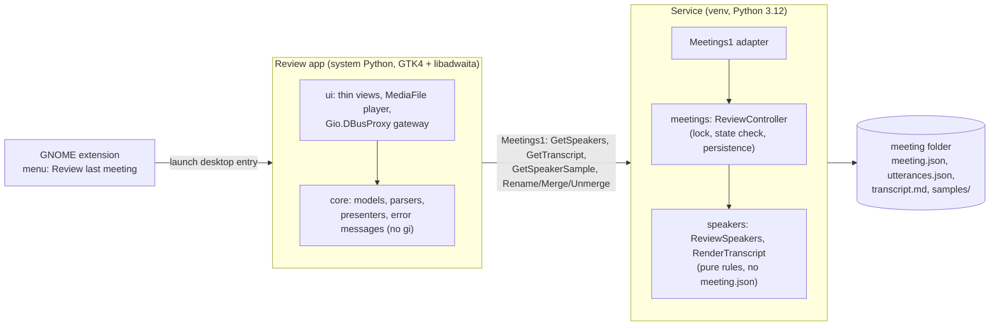

# Spec: Review app (name speakers, merge duplicates, read the transcript)

## Goal (one sentence)

After a meeting is processed, the user opens a native GNOME window from the panel menu, hears a short voice sample
of each detected speaker, gives each one a name, merges speakers that were split by mistake, and reads the
transcript with those names, while the service stays the only writer of meeting data.

---

## Users / Personas

| Persona | How they use the feature |
|---|---|
| The developer (single user) | Gets "Meeting processed: N speakers", clicks "Review last meeting" in the panel menu, plays each sample, names speakers, merges duplicates, reads the result; later reopens older meetings from the list |

---

## User stories

- **US-1**: As the user, I want one menu click to open the review of my last meeting, so that reviewing costs no navigation.
- **US-2**: As the user, I want to hear a short sample of each speaker, so that I can tell who is who without reading the whole transcript.
- **US-3**: As the user, I want to give a speaker a name, so that every line of that speaker in the transcript shows it.
- **US-4**: As the user, I want to merge two speakers that are really one person, and undo it if I was wrong, so that a wrong guess costs nothing.
- **US-5**: As the user, I want to read the transcript with timestamps and names, so that I can check the result before a summary (F5).
- **US-6**: As the user, I want a list of my meetings in the app, so that I can review an older one.
- **US-7**: As the user, I want my names and merges to be saved at once and to be visible in `transcript.md`, so that nothing is lost when I close the window and any later export uses them.
- **US-8**: As the user, I want clear messages when the service is not running, a meeting is still processing or a sample is missing, so that I know what to do next.

---

## Acceptance criteria (Gherkin to tests)

Test paths are the planned locations; the task that builds each one is in [Task breakdown](#12-task-breakdown).
"Service" criteria run against fakes and a private bus; "app" criteria run on presenters with a fake gateway and a
fake player. No test plays audio.

### AC-1: Speakers are listed with their effective names

```gherkin
GIVEN a DONE meeting with speakers ME, S1, S2 where S1 is named "Alex" and S2 is merged into S1
WHEN a client calls GetSpeakers
THEN it gets one row per speaker with id, label, name, display, is_me, talk_seconds, utterance_count,
     has_sample and merged_into
AND the row of S1 has display "Alex" and talk_seconds and utterance_count that include S2
AND the row of S2 has merged_into "S1" and is sorted after the active speakers
```

**Test**: `tests/unit/speakers/test_review_speakers.py::test_effective_speakers_fold_merged_totals_into_the_target`

### AC-2: Rename

```gherkin
GIVEN a DONE meeting with speaker S1
WHEN a client calls RenameSpeaker(meeting, "S1", "  Alex  ")
THEN the stored name is "Alex" (trimmed)
AND meeting.json holds it before the call returns
AND transcript.md shows "Alex" for every line of S1 before the call returns
AND the call returns the refreshed speaker rows
AND SpeakersChanged(meeting) is emitted
```

**Test**: `tests/unit/meetings/test_review_controller.py::test_rename_persists_and_rewrites_the_transcript`

### AC-3: Name validation

```gherkin
GIVEN speakers S1 (label "Speaker 1") and S2 (named "Alex")
WHEN the name is longer than 64 characters or contains a control character (including a line break)
THEN the call fails with INVALID_VALUE and nothing changes
WHEN the name equals, ignoring case and surrounding spaces, the display name of another active speaker
THEN the call fails with SPEAKER_NAME_TAKEN and nothing changes
WHEN the name is empty after trimming
THEN the name is cleared and the speaker shows its label again
```

**Test**: `tests/unit/speakers/test_review_speakers.py::test_name_rules`

### AC-4: Merge

```gherkin
GIVEN active speakers S1 and S3
WHEN a client calls MergeSpeakers(meeting, "S3", "S1")
THEN every utterance of S3 is shown as S1 by GetTranscript and in transcript.md
AND S3 is listed as merged into S1 and is no longer an active speaker
AND the active speaker count of the meeting drops by one in List and Get
AND utterances.json and the sample files are not modified
```

**Test**: `tests/unit/meetings/test_review_controller.py::test_merge_is_non_destructive`

### AC-5: Merge rules

```gherkin
WHEN the source equals the target, or either is already merged away, or the source is "Me" (OQ-2)
THEN the call fails with SPEAKER_MERGE_INVALID and nothing changes
GIVEN S3 was merged into S1
WHEN S1 is merged into S2
THEN S3 now points at S2 as well (merge targets are never chained)
WHEN the target has no name and the source has one
THEN the target takes the source's name; otherwise the target's name wins
```

**Test**: `tests/unit/speakers/test_review_speakers.py::test_merge_rules`

### AC-6: Unmerge

```gherkin
GIVEN S3 merged into S1
WHEN a client calls UnmergeSpeaker(meeting, "S3")
THEN S3 is an active speaker again with its own utterances, name and sample
AND the transcript is rewritten accordingly
```

**Test**: `tests/unit/speakers/test_review_speakers.py::test_unmerge_restores_the_speaker`

### AC-7: Edits are allowed only on a finished meeting

```gherkin
GIVEN a meeting that is QUEUED, TRANSCRIBING, DIARIZING, EXTRACTING_SAMPLES, FAILED or UNSUPPORTED
WHEN a client renames, merges or unmerges
THEN the call fails with MEETING_NOT_PROCESSED and nothing is written
GIVEN a Reprocess that is saved while an edit is in flight
THEN the edit and the state change are serialised under one lock and the edit never overwrites the new state
```

**Test**: `tests/unit/meetings/test_review_controller.py::test_edit_refused_unless_done`, `::test_edit_and_reprocess_are_serialised`

### AC-8: The transcript is served as data

```gherkin
GIVEN a DONE meeting with utterances
WHEN a client calls GetTranscript
THEN it gets (speaker_id, start_seconds, end_seconds, text) rows in time order with merges applied
AND the client never needs a file path
GIVEN a meeting with zero utterances
THEN GetTranscript returns an empty list and the app shows "No speech detected"
```

**Test**: `tests/e2e/meetings/test_review_over_dbus.py::test_get_transcript`

### AC-9: Voice samples are served as data

```gherkin
GIVEN speaker S1 with a sample and speaker S4 without one
WHEN a client calls GetSpeakerSample(meeting, "S1")
THEN it gets the WAV file content as bytes
WHEN it asks for S4
THEN it gets ENTITY_NOT_FOUND_SPEAKER_SAMPLE
AND the app shows the row without a play button and the text "No sample"
```

**Test**: `tests/e2e/meetings/test_review_over_dbus.py::test_get_speaker_sample`, `tests/unit/review_app/test_review_presenter.py::test_row_without_sample_has_no_play`

### AC-10: Names survive a crash and a restart

```gherkin
GIVEN a rename saved to meeting.json but a crash before transcript.md was rewritten
WHEN the service starts, or GetTranscript or the next edit runs
THEN the stale transcript.md is rewritten from utterances.json and the saved names
AND meeting.json is never left half written
```

**Test**: `tests/unit/meetings/test_review_controller.py::test_stale_transcript_is_repaired`

### AC-11: Reprocess resets the review

```gherkin
GIVEN a DONE meeting with names and merges (OQ-1)
WHEN it is reprocessed and finishes again
THEN names and merges are cleared, speakers come from the new run and SpeakersChanged is emitted
```

**Test**: `tests/unit/meetings/test_meeting.py::test_reprocess_clears_the_speaker_review`

### AC-12: The app reaches the service only over D-Bus

```gherkin
GIVEN the app package
WHEN make imports runs
THEN the app imports neither meeting_scribe nor pydantic, returns or dbus_fast
AND its presenters and core modules never import gi
```

**Test**: `make imports` (new contracts in section 6)

### AC-13: Open the last meeting

```gherkin
GIVEN the app is started with no argument and the service lists meetings
THEN it selects the newest meeting whose state is DONE
GIVEN no meeting is DONE
THEN it shows the empty state "No reviewed meetings yet" with the processing state of the newest one
GIVEN the app is already open and the menu action runs again
THEN the existing window is shown (single instance), not a second one
```

**Test**: `tests/unit/review_app/test_meeting_list_presenter.py`, `tests/unit/review_app/test_application_args.py`

### AC-14: Playback is explicit and one at a time

```gherkin
GIVEN a review window with samples
WHEN the window opens, a meeting is selected, or a rename or merge completes
THEN nothing plays
WHEN the user presses play on speaker A and then on speaker B
THEN A stops and B plays
WHEN the user presses play on the playing speaker, switches meeting or closes the window
THEN playback stops
```

**Test**: `tests/unit/review_app/test_playback_presenter.py` (fake player, never a real device)

### AC-15: Failures are shown with a next step, never a stack trace

```gherkin
GIVEN the service is not running and cannot be activated
THEN the app shows "The Meeting Scribe service is not running" with the command to start it and a Retry button
GIVEN the service answers UnknownMethod for a review member (older service still running)
THEN the app says the service must be restarted to match this app version
GIVEN any dev.meetingscribe.Error.<CODE> from the service
THEN the app shows the message mapped to that CODE, and for an unmapped code a generic message with the code
AND no speaker name or transcript text is written to the log
```

**Test**: `tests/unit/review_app/test_error_messages.py` (includes a drift test: every code a review call can return has a message)

### AC-16: The panel menu opens the review

```gherkin
GIVEN the service is available
THEN the menu shows "Review last meeting"
WHEN the user activates it
THEN the extension launches the app through its desktop entry, with no argument and no meeting data
GIVEN the launch fails
THEN the extension shows one notification telling the user to run make install
```

**Test**: `gnome-extension/tests/indicatorModel.test.js`, `gnome-extension/tests/indicatorController.test.js`

### AC-17: Install and uninstall

```gherkin
GIVEN make install runs
THEN the app and its launcher are installed next to the service version, a desktop entry is installed,
     and the summary says whether system Python has the GTK4, libadwaita and PyGObject it needs
AND a missing system package never fails the install
GIVEN make uninstall runs
THEN the app, launcher and desktop entry are removed and meetings are untouched
```

**Test**: `tests/unit/test_install_scripts.py`

---

## What this is NOT (out of scope for this spec)

- Not summaries, the cloud provider label or the per-request cloud confirmation: F5 (the app gets a summary view then).
- Not audio editing, a waveform or seeking inside the meeting audio: only the per-speaker sample is played.
- Not speaker identity across meetings (voice embeddings, name memory, name suggestions): out of the MVP (OQ-5).
- Not starting, stopping or reprocessing from the app: the extension and `Meetings1.Reprocess` keep those.
- Not editing transcript text, splitting a speaker in two or moving single utterances between speakers.
- Not deleting meetings or audio (retention is a later improvement).
- Not an HTTP surface, not direct reads of meeting files by the app (ADR-001, ADR-005).
- Not Flatpak or a distribution package: the app runs from the install directory with system Python.
- Not opening itself after processing, and not opened from the notification (OQ-6): the extension menu is the only desktop entry point; a window never steals focus.

---

## Edge cases

| Case | Expected behavior |
|---|---|
| Meeting has only "Me" (a solo recording) | Listed with one row; merge is disabled (no target); rename allowed |
| Meeting has zero speakers (no speech) | Speaker list shows "No speech detected"; transcript empty; no edit controls |
| Speaker has no sample (no clean turn of 1.5 s) | Row without play button, text "No sample"; rename and merge still work (AC-9) |
| `samples/<id>.wav` listed in `meeting.json` but missing or unreadable on disk | `GetSpeakerSample` fails with `ENTITY_NOT_FOUND_SPEAKER_SAMPLE`; logged at WARNING with the code only |
| `utterances.json` missing or corrupt in a DONE meeting | `GetTranscript` and edits fail with `MEETING_CORRUPT`; the app shows "This meeting's transcript is damaged. Reprocess it." |
| Meeting still processing when the app opens | The row shows the stage; the review pane is read-only with a banner; it enables itself when `ProcessingFinished` arrives |
| Meeting is reprocessed while open (from the menu or `gdbus`) | `ProcessingStateChanged` makes the pane read-only; after `DONE` the app reloads speakers and transcript (AC-11) |
| Two windows or a second client edit the same meeting | Last write wins per call; each call returns the fresh rows and emits `SpeakersChanged`, so every client refreshes |
| Rename to the same name the speaker already has | No-op success; no write, no signal |
| Name that is another speaker's default label ("Speaker 2") | `SPEAKER_NAME_TAKEN` (it would be ambiguous in the transcript) |
| Name containing markdown characters (`*`, `_`, `[`) | Stored as typed; escaped when `transcript.md` is rendered, shown verbatim in the app |
| Name with Unicode (accents, non-Latin) | Accepted; normalised to NFC; length counted in code points |
| Merge a speaker that has a name into one without | Target takes the name (AC-5); the source keeps its own name; Unmerge gives the name back (section 9) |
| Rename a speaker that is merged away | Fails with `SPEAKER_MERGE_INVALID`; unmerge it first |
| Unmerge when the restored name clashes with an active speaker | Fails with `SPEAKER_NAME_TAKEN`; nothing changes |
| Unmerge when its old target was since merged into a third speaker | Source becomes active again on its own; the third speaker keeps the other merged children |
| `meeting.json` from a newer schema | Listed `UNSUPPORTED`; edits fail with `MEETING_NOT_PROCESSED`; the file is never rewritten |
| Service restarted by `make install` while the app is open | The proxy reports the name vanishing; the app shows the "not running" state and reconnects when the name returns |
| Service older than the app (restart skipped because a recording was running) | `UnknownMethod` is mapped to "restart the service" (AC-15) |
| Storage moves to the XDG layout (backlog "Later improvements") | No app change: the app never sees a path (section 4) |
| Playback backend missing (no GStreamer WAV plugin) | The player reports an error; the row shows "Cannot play this sample" and the install summary has already warned |
| Very long meeting (4 h, thousands of utterances) | Transcript is virtualised by `Gtk.ListView`; one `GetTranscript` call, well under the D-Bus message limit |

---

## Technical design

### 1. Architecture



Decisions in one line each (details in the sections that follow):

1. **The service is the only writer** of names and merges (ADR-001, ADR-005). The app is a thin client of new `Meetings1` members.
2. **Edits are stored non-destructively in `meeting.json`**: names in `speakers[].name` (a field F3 already reserved), merges as a `merged_into` map. `utterances.json` and `samples/` are never modified, so Unmerge is exact and Reprocess is a clean reset.
3. **The app never learns a path**: the transcript is returned as rows, a sample as WAV bytes. This is what keeps the app valid when the storage layout changes (backlog "Later improvements").
4. **The app is stdlib plus PyGObject only**, in a top-level `review-app/` directory outside the `meeting_scribe` package, installed next to the service version and run by `/usr/bin/python3`.
5. **The entry point is the extension menu** (OQ-6); the app is a single-instance `Adw.Application`.

### 2. Who writes names and merges

**Recommendation: new members on `Meetings1`, not a separate `Speakers1` interface.** ADR-001 sketched
`Speakers1` (rename/merge/sample path) with the note that names are renamable until F6 (CR-011). A `Speakers1`
adapter would live in `speakers/infrastructure/dbus/` and would need `meeting.json`, which belongs to `meetings`;
domains must not cross (CR-001). Putting the members on `Meetings1`, whose adapter already depends on the
`meetings` controllers, keeps the dependency direction: `meetings` calls the `speakers` application layer (CR-003).
`api-contracts.md` is updated in the same commit as the code and its "Out-of-scope members" row for `Speakers1`
is replaced by a note that the members live on `Meetings1`. This is a naming change inside the room CR-011
leaves, so it needs no new ADR.

**Fine-grained methods, not one `SetSpeakers`.** Each user action is one call with one validation outcome
(`RenameSpeaker`, `MergeSpeakers`, `UnmergeSpeaker`), each returns the refreshed rows. A bulk `SetSpeakers`
would force the app to compute merge rules and would make a conflict (two clients) impossible to explain.

**Where the code goes.**

| Layer | New code | Rule it enforces |
|---|---|---|
| `speakers/domain` | `SpeakerRecord` (value), `validate_name`, `merge`, `unmerge`, `effective_speakers`, `effective_utterances` | Pure functions; names, merge rules, totals; no `meeting.json` |
| `speakers/application` | `ReviewSpeakers` (apply a command to records plus the merge map), `RenderTranscript` (load utterances, render with names, write `transcript.md`) | Uses a new `UtterancesStore` port; reuses `render_transcript` and `SpeakerLabel.display` |
| `speakers/infrastructure` | `json_utterances_store.py` (read `utterances.json`, atomic write of `transcript.md`; no numpy needed) | Atomic temp file plus `os.replace` |
| `meetings/domain` | `SpeakerReview` section on `Meeting` (`merged_into`, `transcript_stale`), `Meeting.with_speaker_review(...)`, `reprocess()` and `complete()` reset it | Entity stays frozen, transitions return copies (CR-006) |
| `meetings/application` | `ReviewController`: read-modify-write under the processing controller's lock; refuse unless `DONE`; persist, then render, then clear the stale flag | Returns `Result` (CR-004) |
| `meetings/infrastructure/dbus` | The new members and the `SpeakersChanged` signal on `MeetingsInterface` | Thin adapter (map `Failure` to a D-Bus error) |

**Where names live.** In `meeting.json`, in `speakers[].name`. The field exists since F3 (`SpeakerEntry.name`, empty
by default) and `SpeakerLabel` already has `name` and `display`. No separate file: a second file is a second source
of truth and a second thing to keep atomic with `meeting.json` (ADR-004 rejected that pattern for the catalog).

**Schema and versioning.** The addition is one optional section with defaults:

```json
"speaker_review": {
  "merged_into": {"S3": "S1"},
  "name_adopted_from": {"S1": "S3"},
  "transcript_stale": false
}
```

`schema_version` stays `1`: an older service ignores and preserves unknown keys (`extra="allow"` on `Meeting`), and
a `meeting.json` without the section loads with the defaults. Bumping the version would make a downgrade refuse the
meeting for no gain. If a later change is not additive, it bumps the version through the repository migration hook
(ADR-004).

**Atomic writes and the transcript.** `meeting.json` is the source of truth and is written atomically by the
repository (temp file, fsync, `os.replace`, fsync of the directory). `transcript.md` is derived and is also written
atomically. The two files cannot be replaced in one step, so the order is:

1. Under the lock, build the new records and save `meeting.json` with `transcript_stale = true`.
2. Render and write `transcript.md` from `utterances.json` and the new records.
3. Save `meeting.json` with `transcript_stale = false`.

A crash after step 1 leaves the stale flag set. `ReviewController.repair_stale()` runs at service start (after
`resume`) and before `GetTranscript` and every edit, and redoes steps 2 and 3. `GetTranscript` never reads
`transcript.md`: it renders from `utterances.json` plus `meeting.json`, so the app is correct even while the file
is stale. If step 2 or 3 fails after step 1, the call fails with `MEETING_STORAGE_FAILED`; the edit is saved and
the next call repairs the file (AC-10). The extra write in step 3 costs one small JSON file per edit.

**What happens on Reprocess (OQ-1).** Speaker ids (`S1..SN`) are numbered by first utterance after diarization, so
they are stable only while the diarization result is unchanged. A reprocess re-runs assembly and may change
parameters, so a stored name could attach to a different person. Recommendation: `Meeting.reprocess()` clears
`speaker_review`, and `complete()` replaces `speakers` (names included) with the new run. The service logs one INFO
line with the meeting id and counts only. The review app has no Reprocess button, and `Reprocess` of a meeting
that was never edited behaves as today. Keeping names by label mapping is rejected for v1: it needs a
fingerprint of the diarization output to know when ids still match, and an error there silently mislabels
speakers in a transcript that may later be sent to an LLM.

**Concurrency.** `ProcessingController` guards state changes with its condition lock, and the processing loop
saves `meeting.json` from its own thread. A review edit is a read-modify-write of the same file, so it must run
under that lock and check `state == DONE` inside it (AC-7). The lock is exposed to `ReviewController` through a
small port (`MeetingLock`), not by sharing the controller object, so `ReviewController` stays testable with a fake.

### 3. Data contracts

`GetSpeakers` row (`a{sv}`), one per `speakers[]` entry, active speakers first (by `talk_seconds` descending, "Me"
first), merged ones after:

| Key | Type | Meaning |
|---|---|---|
| `id` | `s` | Stable id: `ME`, `UNKNOWN`, `S1`..`SN` |
| `label` | `s` | Default label from F3 ("Me", "Unknown", "Speaker 2") |
| `name` | `s` | The user's name; empty when unset |
| `display` | `s` | `name` if set, else `label` (computed once, in the service, by `SpeakerLabel.display`) |
| `is_me` | `b` | The "Me" speaker |
| `talk_seconds` | `d` | Own time plus the time of every speaker merged into it |
| `utterance_count` | `i` | Same folding |
| `has_sample` | `b` | A sample file is listed for this speaker |
| `merged_into` | `s` | Target id when merged away, else empty |

`GetTranscript` row (`(sdds)`): `(speaker_id, start_seconds, end_seconds, text)`, in time order. `speaker_id` is the
effective id after merges, to be joined with the `GetSpeakers` rows by the app. Text is plain; no markdown.

`GetSpeakerSample` returns the WAV file as `ay` (mono, 16 kHz, 16-bit, at most about 0.5 MB, section 5 of
`processing.md`). The method rejects a speaker id that is not in `meeting.json`, so the id never reaches a path
join unchecked (no traversal).

### 4. How the app reaches samples and transcript without knowing the layout

Three options were weighed for the sample.

| Option | Pros | Cons |
|---|---|---|
| Return the absolute path (as `transcript_path` does) | Simplest; `Gtk.MediaFile.new_for_filename` | The app reads meeting files directly, against ADR-005 ("no direct file access to meeting data"); the path is layout knowledge |
| Return an open file descriptor (`h`) | No path, no copy | `Gtk.MediaFile.new_for_input_stream` on a pipe or non-seekable stream is not proven; fd passing needs `Gio.UnixFDList` plumbing in both ends |
| **Return the bytes (`ay`)** | No path, no file written by the app, privacy by default (the sample exists only in memory), works unchanged after the storage move | Copies up to 0.5 MB per play (negligible); needs a seekable in-memory stream |

**Recommendation: bytes.** The app wraps them in `Gio.MemoryInputStream.new_from_bytes` and hands the stream to
`Gtk.MediaFile.new_for_input_stream`. If assumption A-3 fails (the backend refuses the stream), the fallback is a
`0600` file under `$XDG_RUNTIME_DIR/meeting-scribe-review/` (tmpfs, per user), deleted when playback ends and at
app exit; the service API does not change.

The transcript is rows, for the same reason. `Get` keeps returning `directory` and `transcript_path` for the
extension and for humans; the app does not read them and a test asserts that no `ui` or `core` module opens a
path received from the service.

### 5. The `Meetings1` additions (D-Bus)

Same bus name, object path and interface as today ([`api-contracts.md`](../architecture/api-contracts.md) is
updated by F4.3 before the code).

| Member | Kind | Signature | Description | Errors |
|---|---|---|---|---|
| `GetSpeakers` | method | `(s) -> aa{sv}` | Speaker rows (section 3) | `ENTITY_NOT_FOUND_MEETING`, `MEETING_NOT_PROCESSED`, `MEETING_SCHEMA_UNSUPPORTED`, `MEETING_CORRUPT`, `MEETING_STORAGE_FAILED` |
| `GetTranscript` | method | `(s) -> a(sdds)` | Utterances with merges applied; repairs a stale `transcript.md` first | same, plus `ENTITY_NOT_FOUND_TRANSCRIPT` |
| `GetSpeakerSample` | method | `(ss) -> ay` | `(meeting_id, speaker_id)`: the sample WAV | `ENTITY_NOT_FOUND_MEETING`, `ENTITY_NOT_FOUND_SPEAKER`, `ENTITY_NOT_FOUND_SPEAKER_SAMPLE`, `MEETING_NOT_PROCESSED` |
| `RenameSpeaker` | method | `(sss) -> aa{sv}` | `(meeting_id, speaker_id, name)`; empty name clears it; returns the refreshed rows | `INVALID_VALUE`, `SPEAKER_NAME_TAKEN`, `ENTITY_NOT_FOUND_SPEAKER`, `MEETING_NOT_PROCESSED`, `MEETING_STORAGE_FAILED`, plus the lookup errors |
| `MergeSpeakers` | method | `(sss) -> aa{sv}` | `(meeting_id, source_id, target_id)` | `SPEAKER_MERGE_INVALID`, `ENTITY_NOT_FOUND_SPEAKER`, `MEETING_NOT_PROCESSED`, `MEETING_STORAGE_FAILED`, plus the lookup errors |
| `UnmergeSpeaker` | method | `(ss) -> aa{sv}` | `(meeting_id, speaker_id)`; no-op success when the speaker is not merged | `ENTITY_NOT_FOUND_SPEAKER`, `MEETING_NOT_PROCESSED`, `MEETING_STORAGE_FAILED`, plus the lookup errors |
| `SpeakersChanged` | signal | `(s)` | `(meeting_id)` after any edit and after a reprocess clears the review | n/a |

Behavior change to existing members: `speaker_count` in `List` and `Get` becomes the **active** count after merges
(`len(speakers) - len(merged_into)`), so the menu and the app agree. `ProcessingFinished` is a processing fact and
keeps the number of speakers the run detected (the notification already used it). `GetSpeakers` is the way to read
the effective rows.

**New error codes** (registered in the [catalog](../architecture/error-codes-catalog.md) by the task that adds them):

| Class | `error_code` | Package | Notes |
|---|---|---|---|
| `EntityNotFoundError(detail_code="SPEAKER")` | `ENTITY_NOT_FOUND_SPEAKER` | speakers | Unknown speaker id in this meeting |
| `EntityNotFoundError(detail_code="SPEAKER_SAMPLE")` | `ENTITY_NOT_FOUND_SPEAKER_SAMPLE` | speakers | No sample listed, or the file is gone |
| `EntityNotFoundError(detail_code="TRANSCRIPT")` | `ENTITY_NOT_FOUND_TRANSCRIPT` | speakers | DONE meeting with no `utterances.json` (processed by a build that did not write it) |
| `MeetingNotProcessedError` (subclass of `InvalidStateTransitionError`) | `MEETING_NOT_PROCESSED` | meetings | Review members need state `DONE` |
| `SpeakerNameTakenError` (subclass of `InvalidValueError`) | `SPEAKER_NAME_TAKEN` | speakers | Name equals another active speaker's display name or label |
| `SpeakerMergeInvalidError` (subclass of `InvalidValueError`) | `SPEAKER_MERGE_INVALID` | speakers | Self merge, merged-away source or target, "Me" as source, rename of a merged-away speaker |

Names that are empty, too long or contain control characters use the existing `INVALID_VALUE`. A damaged
`utterances.json` or `meeting.json` uses the existing `MEETING_CORRUPT`. No error message ever quotes a name or a
transcript line: messages carry the meeting id and the speaker id only (ids are not private; names are).

The `speakers` package also raises `TRANSCRIPT_CORRUPT` (damaged `utterances.json`) and `TRANSCRIPT_STORAGE_FAILED`
(`transcript.md` not written); `meetings` maps them to `MEETING_CORRUPT` and `MEETING_STORAGE_FAILED` in F4.2.

### 6. Runtime, packaging layout and import contracts

**Interpreter and toolkit (verified read-only on the development machine, 2026-10-09).**

| Item | Value |
|---|---|
| System Python | `/usr/bin/python3` 3.14.7 |
| PyGObject | `python3-gobject` 3.56.3 (`gi` 3.56.3, imports) |
| GTK | `gtk4` 4.22.4 |
| libadwaita | `libadwaita` 1.9.3 |
| GStreamer | 1.28.6; `gstreamer1-plugins-good` provides the WAV parser, `gstreamer1-plugins-base` provides playback |
| `Gtk.MediaFile` backend | `libgtk-4.so` links `libgstplay` (the GStreamer media backend is built in; no separate `gtk4-media-gstreamer` package exists on Fedora 44) |
| Project venv | Python 3.12.13, where system `gi` is not importable |
| System Python extras | `pydantic` and `returns` are **not** installed |

Consequences:

- The app must run on **both** 3.12 (pytest, pyrefly `python-version = "3.12"`) and 3.14 (production). It uses
  only the standard library, avoids syntax and APIs that differ between the two, and CI-equivalent proof is the
  presenter tests on 3.12 plus an import smoke test on system Python (section 11).
- The app cannot use `pydantic`, `returns` or `dbus_fast`, and cannot import `meeting_scribe` (which would import
  them). It has its own frozen dataclasses and a small `Ok | Err` result type for presenter outcomes. The service
  rule "controllers return `Result`" applies to the service; the app's presenters return values and typed errors
  without raising across the view boundary.
- The D-Bus names are duplicated in the app (bus name, object path, interface, error prefix). A test in the venv
  imports both and asserts they equal `meeting_scribe.base.infrastructure.dbus.constants`, so they cannot drift.
- D-Bus from the app uses `Gio.DBusProxy` (GIO is part of PyGObject; no extra dependency), with the service allowed
  to autostart (unlike the extension, opening the app should wake the service through bus activation).

**Location and layout.** ARCHITECTURE.md already places the review app in a top-level directory outside the
Python package. The app is its own package:

```text
review-app/
  src/meeting_scribe_review/
    __main__.py            # python3 -m meeting_scribe_review
    core/                  # no gi: pure Python
      models.py            # Meeting, Speaker, Utterance (frozen dataclasses)
      parsers.py           # D-Bus plain values -> models (tested with real replies)
      gateway.py           # MeetingsGateway Protocol (async by callback), SamplePlayer Protocol
      errors.py            # D-Bus error name -> user message (gettext-ready)
      names.py             # client-side name checks for instant feedback (the service stays authoritative)
      presenters/          # meeting_list.py, review.py, rename.py, merge.py, playback.py, transcript.py
    ui/                    # the only code that imports gi
      application.py       # Adw.Application, command line, single instance
      window.py            # Adw.NavigationSplitView: meetings | speakers and transcript
      speaker_row.py, dialogs.py, transcript_view.py
      dbus_gateway.py      # Gio.DBusProxy implementation of MeetingsGateway
      media_player.py      # Gtk.MediaFile implementation of SamplePlayer
```

`pytest` gets `review-app/src` on its `pythonpath`; `pyrefly` `project-includes` and `search-path` and the ruff
paths gain the new directory; `gi` has no stubs in the venv, so the `ui` package is excluded from pyrefly or
typed against a local stub (decided in F4.4, recorded in the rules registry).

**Import-linter.** `root_package` becomes `root_packages = ["meeting_scribe", "meeting_scribe_review"]`
(import-linter supports several roots). New contracts, each listed in `ARCHITECTURE.md` (the drift test requires it):

| Contract | Type | Rule |
|---|---|---|
| The app core never imports gi | forbidden | `meeting_scribe_review.core` must not import `gi` |
| The app and the service are independent | independence | `meeting_scribe` and `meeting_scribe_review` import each other never |
| The app has no service-side dependencies | forbidden | `meeting_scribe_review` must not import `pydantic`, `pydantic_settings`, `returns`, `dbus_fast`, `numpy` |
| App layers | layers | `meeting_scribe_review.ui` over `meeting_scribe_review.core` |

The existing contracts (domain independence, layering, no settings in domains, no ML libraries in the service) are
unchanged and keep covering the new `speakers` and `meetings` modules, which need no new dependency.

### 7. Audio playback

- The player is a `SamplePlayer` port: `play(bytes) -> None`, `stop() -> None`, plus a callback on end or error.
  The `ui` adapter wraps `Gtk.MediaFile.new_for_input_stream(Gio.MemoryInputStream.new_from_bytes(...))`.
- Playback starts **only** from a press on a play button (safety rule 1, AC-14); one stream at a time; the
  adapter stops and drops the stream on stop, on switching, on window close and when the sample is replaced.
- The sample is requested on the first press for a speaker (not when the list loads), and kept for the window
  lifetime in memory only, so a second press is instant and nothing touches the disk.
- No sample: no play button, text "No sample" (AC-9). Playback error: the row shows "Cannot play this sample" and
  logs the GStreamer error domain and code only.
- Output goes to the user's default sink through GStreamer. The app never records, never opens a source and never
  routes to the monitor that the recorder reads. Tests never construct a real `Gtk.MediaFile`.

### 8. Launch and install

**Entry points.**

| Entry | Mechanism | Scope |
|---|---|---|
| Panel menu "Review last meeting" | New menu action `review`; the controller calls an injected `launchReview()`; `extension.js` implements it with `Gio.DesktopAppInfo.new('dev.meetingscribe.Review.desktop').launch([], null)` (thin glue, CR-012) | F4.7 |
| Command line | `meeting-scribe-review [--meeting ID]`; no argument opens the newest `DONE` meeting | F4.5 |

The extension does not pass a meeting id: it never calls `List` or `Get` (the meetings client contract), and the
app resolves "last" itself, so the extension stays free of meeting data. The menu item is shown whenever the
service is available and the recording state is not `RECORDING`, because the extension cannot know whether a
`DONE` meeting exists; an empty state in the app covers that case (AC-13).

**Single instance and Wayland.** The app is an `Adw.Application` with id `dev.meetingscribe.Review`, which gives it
a unique bus name (single instance, a second launch activates the first) and sets the Wayland `app_id` that
GNOME Shell matches to the desktop entry for the icon and the dock grouping. It requests no special Wayland
protocol. Window size and position are not stored (no `GSettings` schema in v1); the default size is a constant.
The app never calls `present()` on its own after data arrives, so a finished job cannot steal focus.

**Install (`make install`).** The app is installed into the same `versions/<id>/` directory as the service so a
rollback restores both, and `current` switches them together:

1. Copy `review-app/src/meeting_scribe_review/` to `$version_dir/app/meeting_scribe_review/`.
2. Write the launcher `$version_dir/bin/meeting-scribe-review`, a shell script rendered in bash (no `sed`
   replacement, as for the unit): `PYTHONDONTWRITEBYTECODE=1 PYTHONPATH="<dir>/app" exec /usr/bin/python3 -m meeting_scribe_review "$@"`.
   The interpreter is the absolute system path on purpose: it must not resolve to a venv or `uv` Python.
3. Render `packaging/applications/dev.meetingscribe.Review.desktop.in` into
   `$DATA_HOME/applications/dev.meetingscribe.Review.desktop` with `Exec=<current>/bin/meeting-scribe-review`
   (the stable `current/` path, like the unit), `Icon=audio-input-microphone`, `Categories=GNOME;GTK;Utility;`,
   `StartupNotify=true`, `StartupWMClass=dev.meetingscribe.Review`, `DBusActivatable=false`.
4. Check system Python read-only: `/usr/bin/python3 -c 'import gi; gi.require_version("Gtk","4.0"); gi.require_version("Adw","1")'`.
   A failure is reported in the summary with the package names to install (`python3-gobject`, `gtk4`,
   `libadwaita`, `gstreamer1-plugins-good`) and never fails the install (like the extension and the models).
5. Run `update-desktop-database` on the applications directory when it exists (best effort).
6. Summary line: `review app: ready` or `review app: NOT usable (missing: ...)`.

`make uninstall` removes the desktop entry; the launcher and the app go with `versions/`. Neither touches
meetings. Old versions are pruned by the existing logic. A `make run-review-app` development target starts
the app from the working tree with system Python (`PYTHONPATH=review-app/src`), only on the user's explicit
go, because it opens a window and the service it talks to may hold private meetings.

### 9. Merge semantics

| Topic | Rule |
|---|---|
| Direction | The user picks the source (the speaker to remove) and the target (the one that stays) |
| Effect | Non-destructive: `merged_into[source] = target`; targets are never chained (merging a speaker that already has merged children repoints them to the new target) |
| Transcript | Utterances of the source are shown as the target; adjacent utterances of the same effective speaker are **not** coalesced in v1 (the transcript stays lossless and timestamps are unchanged) |
| Totals | `talk_seconds` and `utterance_count` of the target include the merged speakers |
| Samples | Kept for every speaker; a merged speaker's sample stays reachable in the "Merged" section so the user can verify a merge and undo it |
| Names | The target's name wins; if the target has none and the source has one, the target takes it and `name_adopted_from[target] = source` records it; the source keeps its own name |
| "Me" | Can be a target, cannot be a source (OQ-2); renaming is allowed |
| "Unknown" | A normal source; it can be merged into "Me" or a numbered speaker |
| Undo | `UnmergeSpeaker` restores the state before the merge: the source is active again with its own record, and the target gives back the name it adopted from this source (its name is cleared) unless the user renamed the target since (any rename of the target forgets the adoption, so its current name is kept). If the source's own name now clashes with another active speaker (same rule as rename), the call fails with `SPEAKER_NAME_TAKEN` and nothing changes. No-op success when the speaker is not merged. There is no undo stack for renames, a rename is its own undo |
| Rename of a merged speaker | Only active speakers can be renamed: a merged-away speaker fails with `SPEAKER_MERGE_INVALID` until it is unmerged |
| Reprocess | Clears everything (OQ-1) |

**Name validation** (service authoritative, mirrored client-side for instant feedback):

- NFC normalise, strip leading and trailing whitespace, collapse nothing else.
- Empty after trimming clears the name.
- At most 64 code points; no Unicode control (`Cc`) or format (`Cf`) characters, which rules out line breaks that
  would corrupt `transcript.md`.
- Unique, case-insensitively, among the other **active** speakers' display names and default labels
  (`SPEAKER_NAME_TAKEN`, OQ-3). On that error the app tells the user the name is already used and offers two
  ways out: merge into that speaker (same person), or edit the name to tell them apart (for example a surname).
- Markdown-significant characters are accepted and escaped by the transcript renderer.

**Privacy.** Names and transcript text are private meeting data (BR-002). Neither the service nor the app logs
them, includes them in an error message, a notification or a D-Bus error, or writes them anywhere except
`meeting.json` and `transcript.md` in the meeting folder. The app keeps them in memory only, writes no cache and
no recent-names list, and sends nothing anywhere. Logs carry meeting ids, speaker ids, counts and error codes.

### 10. Which meetings

The window is an `Adw.NavigationSplitView`: a sidebar of meetings and a content pane for the selected one. The
sidebar comes from `List` (date and time from `started_at` in the user's locale, duration, active speaker
count, state); the user decided that the list belongs in the app and that the menu "open" action opens the
summary in F5, so the menu never lists meetings. The app does not show folder ids (the backlog plans readable
folder names and an XDG storage move). Meetings that are not `DONE` are listed with their state and open
read-only. The content pane has two sections: **Speakers** (rows with play, name entry, merge and unmerge) and
**Transcript** (a `Gtk.ListView` of timestamp, speaker display name and text). The list refreshes on
`ProcessingFinished`, `ProcessingStateChanged` and `SpeakersChanged`.

### 11. Test strategy

| Level | What | How |
|---|---|---|
| Speakers domain (unit) | Name rules, merge, unmerge, effective speakers, effective utterances, markdown escaping in rendering | Plain values; no files |
| Meetings (unit) | `SpeakerReview` section, `reprocess()` reset, `ReviewController` (state check, ordering, stale flag and repair, lock) | In-memory repository, fake `UtterancesStore`, fake `MeetingLock`, fake clock (CR-009) |
| Adapters (unit) | `json_utterances_store` (atomic transcript write, truncated or corrupt file), sample read | `tmp_path` with generated WAV bytes and JSON; no real meeting |
| D-Bus (e2e) | Every new member, signature, error name and `SpeakersChanged` | Private `dbus-daemon` (GO-025), `dbus_fast` client, fakes behind the controllers |
| App core (unit, venv 3.12) | Parsers, presenters, error-message drift, name checks, constants drift | Fake gateway (synchronous callbacks) and fake player; **parsers are fed the unpacked replies of the real `MeetingsInterface`** on the private bus, so the contract is tested end to end without `gi` |
| App views | Import smoke on system Python: every `ui` module imports under `/usr/bin/python3` with `Gtk 4.0` and `Adw 1`; skipped when `gi` is missing | `subprocess` with `-I`; constructs no window and plays nothing |
| Install | Desktop entry rendered, launcher path, missing-package warning does not fail, uninstall removes | Fake commands on `PATH`, as in `test_install_scripts.py` |
| Extension | Menu item, controller call to `launchReview`, failure notification | `gjs -m` tests with the injected launcher |
| Manual with consent | Real window under Wayland, real playback of a synthetic tone sample, a real review of the user's own meeting | Only on the user's explicit go; nothing from it enters the repo, logs or docs |

There is no UI automation (ADR-005). No test opens an audio device, plays audio or reads
`~/Documents/meetings/`.

### 12. Task breakdown

Advisory size: about 400 authored lines per work unit (not a cap). Order is the work-unit order; each unit ships
its tests and docs.

| Task | Content | Rough size |
|---|---|---|
| F4.1 | `speakers` domain and application: `SpeakerRecord`, name rules, merge, unmerge, effective speakers and utterances, `ReviewSpeakers`, `RenderTranscript` (markdown escaping), `UtterancesStore` port and JSON adapter, new speakers errors, no new dependency | ~400 |
| F4.2 | `meetings`: `SpeakerReview` section, reset on reprocess and complete, active speaker count, `MeetingLock` port, `ReviewController` (state check, write order, stale repair at start), error classes `MeetingNotProcessedError` | ~350 |
| F4.3 | `Meetings1` members and `SpeakersChanged`, wiring in `main.py`, `api-contracts.md` first, error catalog, e2e on a private bus | ~400 |
| F4.4a | `review-app/` scaffold, `core/models`, `parsers`, `gateway` and `player` ports, `errors`, constants drift test, import-linter roots and contracts, pytest, ruff and pyrefly paths, `ARCHITECTURE.md` contract list | ~350 |
| F4.4b | `core/presenters`: meeting list, review (speakers and transcript), rename, merge, playback; name checks | ~400 |
| F4.5a | `ui`: application and command line, single instance, window with split view, meeting sidebar, transcript list, `dbus_gateway`, import smoke test | ~400 |
| F4.5b | `ui`: speaker rows, rename and merge dialogs, unmerge, `media_player`, "service not running" and read-only banners | ~400 |
| F4.6 | Packaging: launcher, desktop entry template, `install.sh` and `uninstall.sh` changes with the system-package check and summary, `make run-review-app`, install tests, runbook `docs/runbooks/review-app.md` | ~300 plus docs |
| F4.7 | Extension: "Review last meeting" item, `launchReview` glue, failure notification, `gjs` tests | ~200 |
| F4.8 | Validation with the user's consent (window, playback, a real meeting), rules-registry entries, `mvp-scope.md` traceability for FR-5, README, backlog, docs gate | ~150 plus docs |

---

## Library facts to verify (Context7, before the task that depends on each)

| Fact | Needed by | Status |
|---|---|---|
| `Gtk.MediaFile.new_for_input_stream` accepts a `Gio.MemoryInputStream` and plays WAV through the GStreamer backend | F4.5b | Not verified (A-3) |
| `Adw.NavigationSplitView`, `Adw.Application`, `Adw.AlertDialog` (1.9) API names and signals | F4.5a, F4.5b | Not verified |
| `Gio.DBusProxy.new_for_bus` / `call` with `a{sv}` and `ay` reply unpacking in PyGObject | F4.5a | Not verified |
| import-linter `root_packages` with two roots and the `independence` contract across them | F4.4a | Not verified (A-6) |
| GNOME Shell activates the app named by a notification's `desktop-entry` hint on click | Not needed in F4 (OQ-6: menu only) | Not verified (A-5) |

## Assumptions to confirm

| ID | Assumption | Confirm in |
|---|---|---|
| A-1 | System Python 3.14 with PyGObject 3.56.3, GTK 4.22.4 and libadwaita 1.9.3 can import `Gtk 4.0` and `Adw 1`. **Confirmed (2026-10-09)**: `gi` imports and reports GTK 4.22.4 and Adw 1.9 on this machine; no window was created | Done; F4.5a repeats it as the smoke test |
| A-2 | The `Gtk.MediaFile` GStreamer backend is available without an extra package. **Partly confirmed (2026-10-09)**: `libgtk-4.so` links `libgstplay`; no module directory exists; playback itself was not tried (no audio without the user's go) | F4.8 with consent |
| A-3 | `Gtk.MediaFile.new_for_input_stream` plays a `Gio.MemoryInputStream` of WAV bytes (seekable). If not, use the `$XDG_RUNTIME_DIR` temp file fallback | F4.5b, a synthetic tone, with consent |
| A-4 | A sample is small enough to return as `ay`: at most 15 s of 16 kHz 16-bit mono, about 0.5 MB, far below the D-Bus message limit | F4.3 test with a generated maximum-size sample |
| A-5 | Setting `desktop-entry` on the service's notification makes a click activate the app | Deferred with OQ-6 (backlog); not needed in F4 |
| A-6 | import-linter allows two `root_packages` and an `independence` contract between them | F4.4a |
| A-7 | `Gio.DesktopAppInfo.launch` from the shell process is acceptable for a short-lived launch (no blocking, no ML) and stays within ADR-001 | F4.7 |
| A-8 | The extension can hide or show the item from state it already has (service available, not recording) without calling `List` | F4.7 |
| A-9 | Speaker ids `S1..SN` are unique per meeting and never contain path characters (they are `ME`, `UNKNOWN`, `S<digits>`); `GetSpeakerSample` still checks the id against `meeting.json` | F4.1 |

## Product decisions

All six questions were answered by the owner (OQ-1 on 2026-10-09, OQ-2 to OQ-6 on 2026-10-11).

1. **OQ-1** Reprocess of a meeting that has names or merges: **reset** (option a). Names and merges are cleared,
   because speaker ids are only stable while diarization is unchanged and a name attached to the wrong person is
   worse than a lost one. Keeping them by a diarization fingerprint can be added later.
2. **OQ-2** Merge and rename rules: **"Me" can be a merge target but never a source**; "Unknown" is a normal
   source and can be merged into "Me" (it is mic speech that was not clearly the user, often the user speaking
   softly) or into another speaker; both can be renamed (for example "Unknown" was a colleague in the room).
3. **OQ-3** Duplicate names: **rejected** with `SPEAKER_NAME_TAKEN`. The app says the name is already used and
   offers to merge into that speaker or to edit the name to tell them apart (for example a surname).
4. **OQ-4** Undo of a merge: **included** (`UnmergeSpeaker`); a merge is stored non-destructively.
5. **OQ-5** Name suggestions from earlier meetings: **none in F4**; names are typed by hand. Recorded in the
   backlog as a later improvement, to be designed with cross-meeting voice recognition.
6. **OQ-6** Opening the review from the notification: **no, menu only** in F4 ("Review last meeting"). A
   notification action is recorded in the backlog as a later improvement.

## Definition of Done

- [ ] All acceptance criteria pass in `make check`
- [ ] The `Meetings1` additions are documented in `architecture/api-contracts.md` before the code (F4.3)
- [ ] New error codes registered in `architecture/error-codes-catalog.md`, with the detail codes under "Known detail codes"
- [ ] Unit tests written first (RED), then implementation (GREEN)
- [ ] Lint, format, type check and import contracts clean, including the four new app contracts, each listed in `ARCHITECTURE.md`
- [ ] The app imports nothing from `meeting_scribe` and runs on `/usr/bin/python3`; the import smoke test passes there
- [ ] `make install` and `make uninstall` handle the app and the desktop entry; a missing system package only warns
- [ ] `docs/runbooks/review-app.md` written (install, requirements, launch, troubleshooting)
- [ ] Traceability for FR-5 filled in `project/mvp-scope.md`; `README.md`, `ARCHITECTURE.md` and the backlog updated
- [ ] New gotchas and rules (Python version split, bytes over D-Bus, merge storage, the write order) in `project/rules-registry.md`
- [ ] Manual validation with the user's consent: real window, real playback of a sample, a review of a real meeting (nothing recorded in the repo)
- [ ] Open product questions answered by the user before the task that depends on each one
- [ ] Docs gate before the integration PR is reported ready (`project/doc-sync-protocol.md`)

---

## Decisions taken during implementation

> If unresolved forks appear, record them here AND open an ADR if the decision is structural.

None yet.
